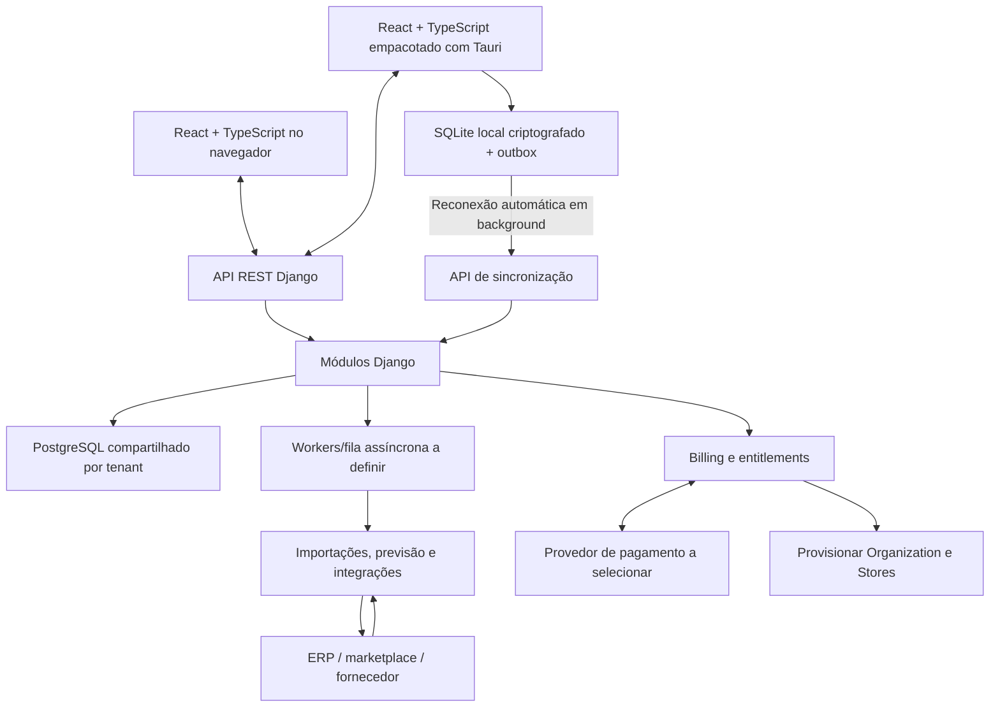

# CompraCerta — arquitetura e plano inicial

**Status:** planejamento revisado, sem implementação  
**Data da revisão:** 6 de novembro de 2026
**Repositório remoto:** [Vitor-Studzieski/ComprasCertas-](https://github.com/Vitor-Studzieski/ComprasCertas-) — clone: `https://github.com/Vitor-Studzieski/ComprasCertas-.git`  
**Referência observada em 6 de novembro de 2026:** público, vazio e com `main` como branch padrão.
**Fluxo de branches:** manter `main` estável; cada tarefa usa branch própria e retorna por pull request.
**Coordenação multiagentes:** papéis de desenvolvimento, worktrees e integração estão em [estrutura-multiagentes.md](estrutura-multiagentes.md).

## 1. Objetivo

O CompraCerta será um **SaaS contratado pela própria plataforma**, inicialmente direcionado a mercados de bairro e lojas de conveniência. Cada rede cria uma conta, escolhe uma assinatura e administra suas lojas, usuários e compras pelo aplicativo Windows `.exe` instalado nos computadores operacionais. A mesma plataforma também fica disponível pelo navegador como acesso online opcional a qualquer momento. As compras são registradas por loja; em etapa posterior, a rede terá uma visão central para acompanhar os pedidos individuais, sem fundi-los em um pedido único. Desde o primeiro ciclo, cada computador terá a mesma interface React empacotada com Tauri, armazenamento local e sincronização automática para continuar as operações previstas durante quedas de conexão. Durante falta de energia, os computadores, o armazenamento local compartilhado e os equipamentos de rede necessários permanecem ativos por no-break. Não é necessário servidor de aplicação local; a rede cliente fornece armazenamento compartilhado e no-break compatíveis, e a instalação valida a conexão e as permissões para as cópias criptografadas.

O sistema deve reduzir rupturas e excesso de estoque sem esconder a decisão em uma pontuação opaca. O primeiro ciclo calcula recomendações com regras transparentes. Etapas posteriores do MVP podem adicionar previsão estatística/ML e um assistente de IA para responder perguntas, comparar cenários e preparar pedidos; ações automatizadas, como aprovar pedidos ou solicitar ajustes de estoque, obedecem a políticas configuráveis. O backend calcula valores, valida limites e registra as decisões.

## 2. Direção de arquitetura

O MVP será um SaaS multi-tenant hospedado centralmente, com uma aplicação modular em Django/Python, API REST e PostgreSQL compartilhado entre redes, com isolamento rigoroso por `organization_id`. Cada `Organization` representa uma rede cliente e seu tenant; cada `Store` é uma loja lógica dentro dessa organização. Os domínios começam como módulos da mesma aplicação e só serão extraídos para serviços independentes se houver necessidade comprovada.

O servidor deriva a organização ativa da identidade autenticada e da associação do usuário; um `organization_id` enviado pelo cliente não concede acesso. Toda leitura e escrita no Django deve ser limitada à organização e às lojas autorizadas. As tabelas com dados de tenant também terão políticas RLS no PostgreSQL como segunda barreira. Quando RLS estiver habilitado sem política aplicável, o PostgreSQL nega o acesso; o proprietário da tabela e papéis privilegiados podem contornar as políticas, então o papel usado pela aplicação e a configuração de RLS precisam ser validados ([documentação do PostgreSQL sobre RLS](https://www.postgresql.org/docs/current/ddl-rowsecurity.html)).

| Componente | Responsabilidade |
|---|---|
| Aplicação web | Interface React com TypeScript, disponível pelo navegador como canal online opcional a qualquer momento, respeitando os mesmos papéis e permissões. |
| Aplicativo desktop Windows | Cliente operacional obrigatório desde o primeiro ciclo, empacotado com Tauri como `.exe` e reutilizando a interface React. Uma instalação pode acessar várias redes se cada administrador autorizar esse computador separadamente. Usa SQLite local criptografado com dados, permissões e filas de sincronização particionados por rede, integração com o sistema operacional, operação offline e sincronização em segundo plano. |
| Identidade e tenant | Cadastro e autenticação por e-mail/senha; passkey/Windows Hello ou chave de segurança como segundo fator para administradores e qualquer pessoa que aprove pedidos ou ajustes, com códigos de recuperação de uso único. `Organization`, lojas, usuários e memberships ficam isoladas por tenant. Uma mesma conta de usuário pode participar de várias redes mediante convite separado e escolhe a rede após entrar. |
| Assinatura e cobrança | Cadastro do plano, checkout dentro da plataforma, assinatura, faturas/eventos de pagamento, cancelamento e ciclo de vida da conta. Provedor de pagamento ainda não escolhido. |
| Entitlements | Direitos habilitados pelo plano — como limites de lojas, usuários, conectores ou recursos de IA — separados das permissões individuais por papel. Não há limite de instalações Windows por plano; cada computador precisa ser autorizado pelo administrador e receber escopo de lojas. Ao atingir o limite de lojas, bloquear a ativação de outra loja; ao atingir o limite de usuários, bloquear novos convites/ativações e oferecer upgrade. Usuários ativos e convites pendentes ainda dentro do prazo ocupam vagas; usuários desativados e convites expirados não contam. Convites expiram após 7 dias; a vaga é liberada e o administrador pode reenviar. Lojas e usuários já ativos continuam operando quando o limite é atingido. |
| API e aplicação Django modular | Módulos de conta, catálogo, vendas/estoque, reposição, compras, billing, políticas/IA e integrações. A API aplica autenticação, autorização e escopo de tenant em toda operação. |
| PostgreSQL central | Um banco compartilhado entre organizações, com `organization_id` obrigatório nos dados de clientes e controles de isolamento na aplicação e no banco. |
| Processamento assíncrono | Importações, tarefas demoradas, webhooks e integrações podem usar workers e fila; a tecnologia e o momento de introdução ainda serão definidos. |
| Armazenamento offline do desktop | SQLite local criptografado e transacional, com partições por organização para dados autorizados, outbox idempotente e cursores por instalação/organização. Uma instalação pode manter cópias locais de várias redes sem cruzar dados, permissões ou operações. |

### Cadastro e contratação SaaS

O fluxo inicial é: cadastrar nome da rede, nome/e-mail do administrador e senha → confirmar o e-mail → iniciar teste grátis de 30 dias sem meio de pagamento → cadastrar a primeira loja, convidar usuários e configurar/importar dados → ao contratar, coletar CNPJ, endereço e dados de cobrança, escolher um plano por porte da rede e concluir checkout → confirmar assinatura pelo provedor de pagamentos. Não exigir CNPJ, endereço ou meio de pagamento para iniciar o teste. A mesma conta pode participar de várias redes somente após convite separado para cada uma; quando tiver mais de uma membership, escolhe a rede ativa após entrar, sem compartilhar dados, papéis ou permissões entre elas. O provedor será comparado posteriormente, considerando cobrança recorrente e meios usados no Brasil. Dados brutos de cartão ficam fora do CompraCerta, no provedor de pagamentos.

O estado da assinatura e as permissões do usuário são controles distintos. A plataforma aplica entitlements no backend e nas APIs, não apenas ocultando recursos na interface. O teste grátis dura 30 dias e não exige cartão no cadastro. Enviar avisos por e-mail antes do fim do teste e durante a carência. Ao fim do teste ou após falha de cobrança recorrente, a rede recebe 7 dias para regularizar; depois, a conta fica em modo de consulta e exportação, sem novas operações, por 90 dias. O prazo de retenção é fixo: no 90º dia, encerrar o acesso e excluir os dados centrais e backups online, após os avisos definidos. Excluir somente os dados e memberships da organização encerrada; preservar contas globais e memberships de seus usuários em outras organizações. Se a pessoa não tiver nenhuma membership, manter a conta global sem acesso aos dados de redes para que possa aceitar novos convites; ela pode solicitar a exclusão da própria conta. A pessoa pode sair de uma rede por conta própria, depois de sincronizar as operações pendentes disponíveis; não pode sair se for o último administrador ativo. Para concluir a exclusão global, a pessoa precisa sair ou ser removida de todas as redes; mostrar quais memberships ainda existem e preservar a regra de que cada rede tenha um administrador ativo. O cancelamento de um plano pago vale no fim do período já pago; até lá, a rede mantém acesso, seguido pelo mesmo prazo fixo de consulta/exportação de 90 dias. Como dispositivos e NAS offline não podem ser apagados remotamente, seus dados locais só podem ser eliminados quando voltarem a se conectar. Se um dispositivo reconectar depois da exclusão, não reabrir a rede nem aceitar sua fila: avisar que as operações locais não serão sincronizadas e apagar a partição, outbox, chaves e backup daquela organização. Operações que não tenham sincronizado até o prazo serão perdidas. Os planos terão número de lojas como critério principal, com limites de usuários e recursos como complementos. Preços e limites exatos continuam a definir.

### Limite operacional offline

Para administradores e usuários que aprovam pedidos ou ajustes, a autenticação online exige passkey/Windows Hello ou chave de segurança; códigos de recuperação são de uso único. No modo offline, esses perfis usam Windows Hello para desbloquear o app e confirmam novamente com Windows Hello antes de aprovar um ajuste de estoque.

O acesso offline desses perfis só é habilitado depois que Windows Hello estiver configurado no computador. Sem essa configuração, o perfil não pode desbloquear o `.exe` offline; o acesso online e o acesso offline dos demais usuários autorizados não são afetados.

Operadores autorizados desbloqueiam o `.exe` offline informando o e-mail da conta e um PIN local de seis dígitos numéricos, configurado após o primeiro login online. O PIN é vinculado à pessoa e à instalação, serve apenas para desbloqueio local e não substitui a autenticação online nem o MFA. Administradores e qualquer perfil que aprove pedidos ou ajustes continuam usando Windows Hello; não podem usar o PIN de operador para desbloquear ou aprovar offline. Depois do desbloqueio, a pessoa escolhe entre as organizações autorizadas que estejam em cache naquele computador e só acessa as lojas permitidas para seu perfil.

O próprio usuário só pode redefinir o PIN após reconectar e autenticar-se online. Enquanto isso, não há redefinição local por gerente nem código de recuperação offline; outra pessoa autorizada pode usar seu próprio acesso no dispositivo.

Após cinco tentativas consecutivas incorretas, bloquear o acesso offline daquele usuário naquela instalação até que o titular autentique-se online e redefina o PIN. O bloqueio não afeta outros usuários autorizados no mesmo computador.

O modo offline é uma contingência para quedas de conexão; o computador precisa continuar ligado (por exemplo, com no-break) para operar durante uma queda de energia. Cada administrador de rede autoriza separadamente a instalação Windows e define as lojas que aquele computador pode sincronizar naquela rede. Depois de login online, o `.exe` armazena somente os dados dessas lojas no SQLite local criptografado, em partição própria da organização. Cada usuário usa sua própria conta e só pode desbloquear offline se tiver sido autorizado no dispositivo para aquela rede e possuir acesso às lojas em cache: operadores informam e-mail e PIN local de seis dígitos configurado após login online, com bloqueio após cinco tentativas consecutivas incorretas até redefinição online; administradores e aprovadores usam Windows Hello. Depois do desbloqueio, a pessoa escolhe uma organização autorizada em cache; ao trocar a rede ativa, mostrar somente os dados e permissões do tenant selecionado, mantendo partições locais isoladas e inacessíveis entre si. O app bloqueia após inatividade. Enquanto o computador tiver energia, a operação offline não tem prazo máximo definido. Alterações de assinatura, permissões ou autorização feitas durante a queda só passam a valer quando a conexão daquela rede retorna. Se o acesso de uma pessoa for revogado durante a desconexão, na reconexão validar e sincronizar suas operações usando o escopo e o papel guardados em cache no momento do registro. Cada operação registra a versão da permissão usada. Após a confirmação do servidor, remover o acesso offline daquela pessoa na organização. Se o administrador revogar a autorização da rede enquanto o computador estiver offline, na reconexão o servidor valida e recebe as operações pendentes daquela organização antes de aplicar a revogação. Só depois da confirmação do servidor apagar a partição, as chaves e os backups daquela organização; outras redes autorizadas e a instalação continuam operando. Se a sincronização não concluir, preservar a outbox e tentar novamente.

Além da base local, o app mantém cópias de segurança criptografadas da base e da outbox em um armazenamento compartilhado da rede local da loja (por exemplo, NAS), atualizadas automaticamente após transações locais. Cada rede cliente fornece/configura seu próprio destino de armazenamento compartilhado e confirma a proteção por no-break; validar conexão e permissões separadamente para cada rede. Manter cópias em partições/diretórios separados por instalação e organização. O NAS serve para backup e restauração, não como banco operacional compartilhado: cada instalação mantém sua própria base e as operações só chegam às outras instalações após sincronizar com o SaaS. Para cada par instalação/organização, manter a cópia mais recente e a anterior verificada. Só substituir a anterior depois que a nova cópia terminar e for validada, preservando uma cópia íntegra se houver falha ou interrupção. O uso online é liberado sem esse equipamento; o modo offline só é ativado depois que a instalação valida leitura/gravação no armazenamento e a pessoa responsável confirma a proteção por no-break dos computadores, armazenamento e rede local. Se um destino já validado ficar desconectado ou sem espaço, continuar operando, avisar sobre a falha, mostrar a data/hora da última cópia concluída e tentar novamente. Durante uma queda, restaurar o backup somente em outra instalação que já tenha sido autorizada online pelo administrador daquela rede, com escopo de lojas definido antes da interrupção. Um computador novo precisa de autorização online antes de receber dados. Após sincronização completa e revogação da autorização daquela rede, apagar as cópias e chaves correspondentes sem afetar outros tenants; uma falha ou interrupção não deve apagar cópias ainda necessárias à recuperação.

O `.exe` permanece na área de notificação do Windows quando a janela é fechada, inicia em segundo plano junto com o Windows por padrão (com opção para desativar) e sincroniza automaticamente ao detectar a conexão. Sair explicitamente encerra o processo; a próxima sincronização ocorre ao reiniciar o app. Cada computador operacional usa o aplicativo Windows desde o primeiro ciclo. O acesso pelo navegador fica disponível como alternativa online, sem paridade offline neste escopo.

A interface do navegador e a do `.exe` bloqueiam após 30 minutos sem interação. O bloqueio da interface não interrompe a sincronização em segundo plano do `.exe` enquanto ele permanecer no tray.

Atualizações assinadas do `.exe` são baixadas automaticamente quando há conexão e ficam prontas para instalar depois que toda a outbox estiver sincronizada. O app avisa a pessoa e instala a atualização no próximo reinício que ela escolher; não reinicia sozinho. Se houver operações pendentes ou erro de sincronização, manter a versão atual e preservar a outbox; não substituir nem apagar dados locais durante a atualização.

Cada dispositivo tem sua própria cópia dos dados. Versões concorrentes do mesmo total diário para SKU/loja/data são preservadas, marcadas como conflito e exibidas ao gerente da loja, que informa o total consolidado. Não somar nem escolher uma versão silenciosamente. Só após essa resolução o sistema atualiza o total central e ajusta o saldo pela diferença, mantendo todas as versões e a auditoria. Se dois dispositivos enviarem ETAs diferentes para a mesma entrega, preservar as duas versões e pedir ao gerente responsável pela loja que escolha a data final, informe o motivo e registre a decisão na auditoria; depois recalcular o risco e os alertas. Outras vendas concorrentes offline também são preservadas e divergências de saldo ficam visíveis para reconciliação, sem descartar registros ou aplicar “última gravação vence”. Se a assinatura mudar enquanto o dispositivo estiver offline, sincronizar primeiro as operações já registradas e depois aplicar o estado atual da assinatura.

### Módulos de domínio

- **Conta SaaS:** onboarding, organização/tenant, lojas lógicas, usuários, convite e ciclo de vida da conta.
- **Billing e entitlements:** teste grátis, checkout, pagamentos, planos por porte da rede e recursos habilitados.
- **Catálogo e fornecedores:** produtos, categorias, unidades, lotes/validade opcionais, fornecedores e condições por produto.
- **Vendas e estoque:** vendas manuais/importadas, livro de movimentações, saldos projetados e recebimentos.
- **Reposição:** regras determinísticas, demanda, cobertura, risco, quantidades e comparação explicável de fornecedores.
- **Compras:** pedidos por loja no primeiro ciclo; visão central para o comprador acompanhar e coordenar pedidos individuais em ciclo posterior; somente o gerente da loja edita fornecedor e quantidades do rascunho e aprova o pedido.
- **Políticas e IA:** consultas, cenários e ações autorizadas em etapa posterior do MVP.
- **Integrações:** camada para ERPs, marketplaces e canais de fornecedores, priorizados a partir de clientes-piloto.
- **Sincronização:** API que valida e concilia eventos offline enviados por cada instalação/dispositivo.

## 3. Fluxo principal

## 4. Domínio e dados centrais

Mudanças no fuso horário de uma loja têm uma data efetiva. Preservar datas operacionais e auditorias anteriores sem reinterpretá-las; usar o novo fuso somente para o período futuro.

Cada rede define um horário padrão de início do dia operacional, e cada loja pode sobrescrevê-lo. A pessoa responsável pela estrutura da rede define o padrão; o gerente responsável pela loja pode definir o horário local da sua loja. A data operacional começa no horário configurado e termina imediatamente antes do horário equivalente do dia seguinte; eventos anteriores ao horário de início pertencem à data operacional anterior. Datas de vendas diárias representam essa data operacional. Mudanças no horário têm data efetiva e preservam as datas históricas já registradas. Nenhum horário inicial fixo está definido.

`Organization` é o tenant contratante; cada `Store` é uma unidade lógica pertencente a um tenant. A rede configura um fuso horário padrão, herdado pelas lojas, com possibilidade de ajuste por loja. Horários técnicos são armazenados em UTC; datas operacionais de venda, data de corte e períodos de orçamento são interpretados no fuso local da loja. Entidades principais usam UUID como identificador estável, inclusive quando forem criadas offline. Todo registro de cliente precisa carregar o escopo de organização e, quando aplicável, o de loja. Operações offline também identificam usuário, dispositivo, versão-base, sequência local e horário UTC informado pelo dispositivo, marcado como provisório. Na sincronização, acrescentar o horário de chegada ao servidor sem substituir o horário do dispositivo; usar a sequência local para ordenar operações do mesmo dispositivo. O UUID da operação permanece igual após a sincronização, enquanto chaves de negócio como SKU/loja/data mantêm restrições únicas próprias. Cada loja registra sua data de corte como o primeiro dia operacional completo após o dia cuja contagem física fechou o saldo. Vendas anteriores servem apenas para calcular demanda e não alteram o saldo inicial; vendas desde a data de corte geram movimentações de saída. Cada pedido continua vinculado à sua loja; a visão central da rede acompanha estados e pendências dos pedidos sem fundir quantidades em um pedido único.

| Entidade | Responsabilidade |
|---|---|
| `Organization`, `Store`, `User`, `Membership`, `StoreAccess` | Conta SaaS/tenant, com nome da rede e dados legais/de cobrança coletados ao contratar; lojas lógicas; identidade global de usuário, com nome/e-mail; vínculo (`Membership`) e papel em cada rede; e lojas às quais cada gerente/operador foi atribuído. O cadastro inicial exige nome da rede, nome/e-mail do administrador e senha; CNPJ, endereço e dados de cobrança são pedidos na contratação. Uma conta pode ter memberships em várias organizações por convite separado; a pessoa escolhe a organização ativa e dados, papéis e permissões permanecem isolados por `organization_id`. Ao excluir uma organização, remover seus dados e memberships, preservando a identidade global e os vínculos do usuário com outras organizações. A pessoa pode encerrar sua própria membership depois de sincronizar as operações pendentes disponíveis; impedir a saída do último administrador ativo até promover outra pessoa. Ao encerrar uma membership, remover o acesso mas preservar o histórico de auditoria com a pessoa identificada como ex-membro. Sem nenhuma membership, manter a conta global sem acesso a redes para aceitar convites futuros; a pessoa pode pedir a exclusão da própria conta, concluída somente após sair ou ser removida de todas as redes. Mostrar quais memberships ainda impedem a exclusão e preservar a regra do último administrador ativo em cada rede. Cada organização deve manter pelo menos um administrador ativo; impedir a remoção/desativação do último até outro usuário receber esse papel. A rede define fuso e horário padrão para o dia operacional; cada loja pode configurar seu próprio fuso e horário de início. Horários técnicos ficam em UTC, enquanto datas de vendas, corte e orçamento seguem o calendário local da loja. A loja registra como data de corte o primeiro dia operacional completo após a contagem física que fechou o saldo do dia anterior. Admin vê a rede toda; comprador tem acesso às lojas necessárias. Admin/comprador importam catálogo e fornecedores; gerente/operador importam vendas e estoque somente nas lojas atribuídas. |
| `UserAuthenticator`, `RecoveryCode`, `MFARecoveryRequest`, `UserSession`, `OfflineUnlockCredential` | Credenciais WebAuthn/passkey, Windows Hello ou chave de segurança para MFA obrigatório de administradores e pessoas que aprovam pedidos ou ajustes. Guardar a chave pública/identificador necessário da credencial e hashes de códigos de recuperação de uso único; nunca armazenar segredos privados da passkey. Para operadores, exigir e-mail da conta e manter credencial de PIN local numérico de seis dígitos, vinculada à pessoa e à instalação, configurada após o primeiro login online; não armazenar o PIN em texto puro. O PIN não substitui autenticação online nem MFA. Só o próprio usuário pode redefinir seu PIN, após reconectar e autenticar-se online; sem conexão, outra pessoa autorizada usa o próprio acesso. Após cinco tentativas consecutivas incorretas, bloquear o acesso offline do usuário naquela instalação até a redefinição online, sem afetar outras pessoas autorizadas. Perda de passkey e de todos os códigos exige solicitação assistida pelo suporte; exigir a senha atual e código/link enviado ao e-mail já confirmado, revisão do pedido, notificação imediata à pessoa e auditoria. Após a revisão, concluir sem período de espera, revogar fatores perdidos e encerrar todas as sessões online. Dispositivos offline sincronizam operações pendentes com o escopo/papel em cache; depois invalidam a sessão local e exigem novo login/MFA antes de continuar. A autorização da instalação não é revogada. Exigir nova passkey antes de restaurar permissões de aprovação. |
| `StoreTimeZoneHistory` | Fuso horário configurado para a loja, herdado do padrão da rede ou definido como ajuste, com data efetiva e autor da mudança. Mudanças valem para datas operacionais futuras; preservar datas e auditorias históricas. |
| `BusinessDayPolicyHistory` | Horário padrão de início do dia operacional definido pela pessoa responsável pela estrutura da rede e ajustes por loja definidos pelo gerente responsável, com data efetiva e autor; preservar datas de vendas, estoque e auditorias já registradas quando a regra mudar. |
| `Plan`, `Subscription`, `BillingEvent`, `Entitlement` | Plano contratado, estado da assinatura, eventos do provedor de pagamento e recursos habilitados por plano, incluindo limites de lojas e usuários. Usuários ativos e convites pendentes dentro do prazo contam para o limite; usuários desativados e convites expirados não contam. Convites expiram após 7 dias, liberam a vaga e podem ser reenviados pelo administrador. Ao alcançar o limite, bloquear novos convites/ativações e oferecer upgrade, mantendo os usuários ativos operando. Os planos não limitam a quantidade de instalações Windows; cada instalação requer autorização explícita do administrador da rede e escopo de lojas definido. |
| `Product` | SKU interno único por rede, código de barras opcional, descrição, unidade-base, categoria e estado ativo. Unidade de contagem exige quantidade inteira; kg/litro permite até três casas decimais. |
| `StoreProduct` | Vínculo entre produto e loja da mesma rede, com data inicial e data final opcional de vigência, indicando quando o produto faz parte do sortimento. Só no período ativo entram os dados de venda completos para esse vínculo e a recomendação de compra. Ao encerrar o vínculo, parar novas recomendações, mas continuar registrando vendas e movimentos para liquidar o saldo restante; preservar o histórico. A combinação produto/loja é única. |
| `UnitOfMeasure`, `UnitConversion` | Unidade-base do produto, tipo de medida (contagem, peso ou volume), escala permitida e conversões explícitas para embalagens de compra. Quantidades usam decimal exato, não ponto flutuante binário; kg/litro aceitam até três casas decimais e valores mais precisos são rejeitados na importação. |
| `ProductLot` | Lote e validade, ativados opcionalmente por produto para perecíveis. |
| `Supplier` | Dados do fornecedor. |
| `SupplierProduct` | Vínculo compartilhado na rede entre produto e fornecedor, com preço, prazo, pedido mínimo, múltiplo de embalagem e disponibilidade; condições específicas podem ser sobrescritas por loja. |
| `DailyProductSales` | Um total de quantidade vendida por produto, loja e data operacional; lançado manualmente ou importado de planilha no primeiro ciclo usando os cabeçalhos exatos do modelo do CompraCerta. A data de corte é o primeiro dia operacional completo após a contagem física que fechou o saldo do dia anterior. Vendas anteriores servem para calcular demanda, sem reduzir o saldo inicial; vendas desde a data de corte também geram movimentação de saída. Após o fim do vínculo produto/loja, vendas explícitas continuam aceitas para liquidar saldo e movimentá-lo, mas não entram na demanda nem geram recomendação. Quantidades respeitam a unidade-base: inteiras para contagem e fracionárias para peso/volume. O CSV usa UTF-8, `;` como separador, vírgula decimal e data `DD/MM/AAAA`; a data no arquivo é a data operacional da loja. SKU/loja/data é único e duplicidades dentro do mesmo arquivo são rejeitadas. Corrigir um total já registrado exige ação explícita, preservando valor anterior, valor novo, responsável e motivo na auditoria; se já tiver movimentado estoque, gerar na mesma transação um movimento compensatório apenas pela diferença e vinculá-lo à correção. |
| `DailyStockAvailability` | Registro explícito por produto, loja e dia de que o produto ficou sem estoque; pode ser lançado manualmente ou importado por um modelo próprio e serve como evidência para excluir aquele dia do cálculo da demanda. A ausência de registro não comprova falta de estoque. |
| `ImportBatch`, `ImportIssue` | Lote de importação, autor, tipo, escopo (incluindo loja e período declarado completo para vendas), hash do arquivo, validações, prévia, erros e estado; os dados só são aplicados após confirmação explícita do usuário. Dentro do período completo, um SKU/dia sem linha de venda significa zero se o vínculo produto/loja estava ativo naquela data; fora do período ou da vigência, a ausência é desconhecida. Vendas explícitas após o encerramento do vínculo podem ser registradas para liquidar estoque, mas a omissão de linha não vira zero e o produto não recebe recomendação. Mudanças nos dados entre prévia e confirmação invalidam a prévia e exigem nova validação integral. |
| `StockMovement` | Livro-razão de entradas e saídas: vendas desde a data de corte, devoluções de clientes que retornam ao estoque vendável, recebimentos, ajustes, perdas ou transferências. Operador ou gerente atribuído à loja pode registrar uma devolução vendável sem aprovação extra, com motivo obrigatório. Uma devolução é um movimento separado, não altera a venda diária original nem a demanda histórica e fica auditada; guardar operador, loja, produto, quantidade, motivo e horário, com referência opcional ao cupom/nota e sem dados pessoais do cliente. Produto não vendável não aumenta o saldo. Histórico não é apagado; correções de vendas já movimentadas criam movimento compensatório pela diferença, vinculado à venda/correção e auditado. Se a venda levar o saldo abaixo de zero, registrá-la integralmente, alertar o gerente e manter o déficit até um ajuste físico auditado. Valor do ajuste usa o último custo unitário real de recebimento confirmado para produto/loja, somando apenas o frete conhecido atribuível; frete informado para o pedido inteiro é rateado entre linhas proporcionalmente ao valor de mercadoria de cada linha e convertido em custo unitário. Se não houver custo, marcar valor desconhecido e exigir aprovação. Registrar o custo e a origem usados na auditoria. Ajustes acima de qualquer limite de rede exigem aprovação; se faltar um ou ambos os limites, todo ajuste exige aprovação. Gerente autorizado naquele dispositivo pode aprová-los offline. |
| `StockBalance` | Saldo atual por produto e loja, mantido como projeção para leitura rápida. No primeiro ciclo, não há reservas separadas; o cálculo usa o saldo resultante das movimentações registradas. Pode ficar negativo; alertar o gerente e usar o déficit na recomendação até reconciliar por contagem/ajuste físico auditado. |
| `PurchaseSuggestion`, `SuggestionItem` | Cálculo, dados de entrada, fornecedores comparados, explicação e versão da regra aplicada. |
| `PurchaseOrder`, `PurchaseOrderItem`, `Receipt` | Pedido vinculado a uma loja, linhas de compra, preço aprovado e recebimentos parciais ou totais com quantidade física e preço unitário real da nota. O rascunho nasce da recomendação; somente o gerente da loja pode editar fornecedor e quantidades antes de aprovar. Guardar valores recomendados e valores editados, com autor e horário; exigir justificativa somente quando a edição abre exceção às regras ou ao orçamento. Revalidar regras, orçamento e dados atuais antes da aprovação. Destacar diferenças de custo; o preço real vira o último custo confirmado. Quantidade física acima do pedido fica pendente, sem entrar no saldo nem comprometer orçamento, até decisão do gerente; se aceita, exige aditivo do pedido e nova validação orçamentária. Frete conhecido no total do pedido é rateado uma única vez pelas linhas conforme seus valores e quantidades originalmente pedidos, gerando um custo fixo por unidade que se aplica a cada recebimento parcial sem repetir o frete. A rede pode acompanhar vários pedidos em uma visão central. |
| `ExpectedDelivery`, `ExpectedDeliveryItem` | Entregas esperadas de cada pedido, com quantidade por produto, confirmação de envio e ETA confirmado. Só quantidades enviadas com data confirmada entram na projeção de estoque; recebimentos parciais reduzem a quantidade esperada da entrega correspondente. O gerente responsável pela loja ou comprador autorizado a acompanhar o pedido pode registrar/alterar o ETA online ou offline. Offline, armazenar a mudança e o alerta localmente com versão-base na outbox; sincronizar depois e preservar versões conflitantes. Mudanças preservam valor anterior/novo, autor e horário, recalculam risco e desatualizam sugestões e rascunhos não aprovados. Se dois dispositivos enviarem datas diferentes para a mesma entrega, não aplicar “última gravação vence”: manter as versões e aguardar o gerente responsável pela loja escolher o ETA final, com motivo e auditoria. Se uma versão offline chegar depois da resolução, abrir novo conflito; manter a resolução anterior no histórico e pedir nova decisão do gerente. Se o risco de ruptura aumentar, gerar alerta no app para o gerente e comprador autorizado, informando produto, ETA antigo/novo e impacto na cobertura. |
| `ReceiptDiscrepancy`, `PurchaseOrderAmendment` | Excedente físico recebido e decisão do gerente de aceitar por aditivo ou recusar. O aditivo revalida o orçamento e compromete seu valor incremental no período semanal/mensal em que o gerente o aprova; também registra cancelamento pelo gerente da quantidade não recebida que o fornecedor confirmou que não entregará. Guardar quantidades, valores, responsável e histórico da decisão. |
| `OperationalAlert` | Alerta no app para alterações de ETA que aumentem o risco de ruptura, direcionado ao gerente da loja e ao comprador autorizado, com produto, datas anterior/nova e impacto previsto na cobertura. Estados aberto/reconhecido/fechado; guardar responsável, ação registrada, motivo e horário. Permanecer aberto até reconhecimento e ação; fechar quando o risco for resolvido ou houver justificativa registrada. |
| `AuditEvent` | Autor, ação, horário e motivo para ajustes, aprovações, rejeições e recebimentos. Guardar referência estável da pessoa e snapshot de nome/papel no momento da ação; após saída da rede, mostrar a pessoa como ex-membro sem alterar os registros imutáveis. Remover a conta global não pode apagar em cascata esses snapshots de auditoria; eles são removidos conforme a retenção da organização. Guardar valores recomendados e editados de fornecedor e quantidade, autor e horário; exigir motivo quando a edição for exceção às regras ou ao orçamento. Para operações offline, guardar o horário UTC informado pelo dispositivo como provisório e acrescentar o horário de chegada ao servidor na sincronização, sem substituir o primeiro. Guardar também a versão do papel/escopo em cache que autorizou a operação, para validar ações de uma pessoa cujo acesso foi revogado durante a desconexão. Para ajuste de estoque aprovado offline, registrar operador, gerente aprovador, dispositivo e confirmação local do Windows Hello antes da aprovação, incluindo resultado e horário; não armazenar segredo biométrico ou PIN. Para limite monetário, guardar o custo unitário real, o recebimento e o rateio de frete usados como base da estimativa. Guardar também o preço aprovado, preço da nota e diferença de cada recebimento. Para mudança ou resolução de conflito de ETA, guardar datas anterior/nova, todas as versões concorrentes, ETA escolhido, gerente responsável, motivo e horário. |
| `DesktopInstallation`, `OrganizationInstallationAuthorization`, `OfflineOperation`, `SyncCursor` | `DesktopInstallation` identifica a instalação física do aplicativo. Cada rede mantém sua própria autorização vinculada a essa instalação, com lojas e usuários permitidos, estado de autorização/revogação e estado de prontidão offline (armazenamento validado e no-break confirmado). Uma instalação pode ter autorizações para várias organizações, sem misturar dados, papéis ou filas locais. A versão do papel/escopo do usuário é incrementada quando suas permissões mudam; cada operação offline guarda essa versão para validação posterior. Guardar versão do aplicativo; operações offline idempotentes; cursores por instalação/organização; e versões sincronizadas de produto, fornecedor e preço usadas. Guardar horário UTC do dispositivo (provisório), horário de chegada ao servidor e sequência local para ordenar eventos do mesmo dispositivo; não usar o relógio local para ordenar eventos de dispositivos diferentes. Na revogação, guardar ator e horário, sincronizar primeiro as operações pendentes correspondentes e registrar a limpeza da respectiva partição após confirmação do servidor. O armazenamento local não é compartilhado entre dispositivos. A navegação web online pode ter sessão própria. |
| `OfflineReadinessCheck` | Validação, por organização, da conexão e das permissões de leitura/gravação no destino de armazenamento compartilhado fornecido/configurado por aquela rede, mais confirmação responsável de que computadores, armazenamento e rede local têm energia protegida. Até aprovar essa verificação para a organização, permitir uso online e manter o modo offline daquele escopo desativado. |
| `OfflineBackup` | Cópias criptografadas da base local e da outbox em armazenamento compartilhado fornecido pela rede cliente e conectado à rede local da loja, vinculadas à instalação e à organização, com sequência coberta, horário e estado da última verificação. O destino é somente para backup/restauração, não para uso da base em tempo real por outros computadores. Manter a cópia mais recente e a anterior verificada por instalação/organização; só substituir a anterior depois de concluir e validar a nova. A instalação valida conexão e permissões para cada organização. As cópias ficam separadas e não expõem dados em claro no destino. Durante uma interrupção, permite restaurar operações ainda não sincronizadas somente em computador substituto já autorizado online pelo administrador para aquela organização e escopo de lojas; um computador novo exige autorização online antes de receber dados. Revogar a autorização apaga apenas as cópias e chaves dessa organização, sem afetar outras autorizações da instalação. |
| `SalesConflict` | Versões concorrentes do mesmo total diário, preservadas por dispositivo e operação; aguardam o gerente da loja informar o total consolidado antes de atualizar a venda e o saldo central. |
| `ExpectedDeliveryConflict` | Versões concorrentes de ETA para a mesma entrega, preservadas por dispositivo e operação; aguardam o gerente responsável pela loja escolher a data final e registrar motivo, autor e horário antes de recalcular risco e alertas. Uma nova versão recebida depois de uma resolução abre outro conflito e não apaga a decisão anterior. |
| `ForecastModelVersion` | Versão do modelo de previsão, período de validade, entradas consideradas e métricas de confiança. |

Unidades de estoque e unidades de compra precisam ter conversões explícitas. Produtos vendidos por contagem usam quantidades inteiras; kg e litro aceitam até três casas decimais. Valores importados com maior precisão são rejeitados e precisam ser corrigidos, sem arredondamento silencioso. Por exemplo, um fornecedor pode vender caixas, enquanto vendas e saldos são registrados em unidades, quilogramas ou litros. O sistema guarda a quantidade normalizada e também a embalagem usada no pedido, com representação decimal exata. A precisão resultante de conversões precisa respeitar a escala permitida pela unidade. Como cada pedido permanece vinculado a uma loja, o recebimento atualiza diretamente o estoque dessa loja. A visão central reúne o acompanhamento sem consolidar as linhas dos pedidos.

Os módulos Django compartilham o PostgreSQL, mas cada módulo mantém responsabilidade clara por suas regras e alterações. Operações relacionadas — como registrar venda, itens e movimentos de estoque — usam transações PostgreSQL. Corrigir uma venda diária que já movimentou o estoque cria, na mesma transação, movimento compensatório apenas pela diferença, ligado à correção e à venda original. Cada importação é registrada como lote com hash do arquivo, autor, escopo, prévia e resultado da validação. Validar o arquivo completo antes de gravar; qualquer erro impede a importação inteira e mostra linha/campo e correção sugerida. Um arquivo válido apresenta contagens de inclusões e atualizações e só é aplicado atomicamente após confirmação explícita. Na confirmação, revalidar contra os dados atuais; se houver mudança ou conflito desde a prévia, não gravar nenhuma linha e emitir nova prévia. No primeiro ciclo, as planilhas devem usar os cabeçalhos exatos dos modelos baixáveis; não há mapeamento livre de colunas. O CSV do modelo usa UTF-8, `;` como separador, vírgula decimal e data `DD/MM/AAAA`. O SKU identifica produtos existentes: importações podem atualizar dados cadastrais, mas nunca sobrescrevem saldo, que muda somente por movimentos de estoque. Para vendas diárias, SKU/loja/data é único; duplicidades dentro do arquivo são rejeitadas para evitar dupla contagem. A correção posterior de um total existente é explícita e auditada, sem criar uma segunda linha para a mesma chave. Efeitos externos futuros, como webhooks e conectores, devem usar outbox e processamento idempotente; fila e workers serão dimensionados quando o primeiro fluxo estiver definido. Toda leitura, gravação, cache, evento, exportação e integração deve preservar o tenant. O controle escolhido combina escopo obrigatório por `organization_id` na aplicação e RLS no banco; papéis, contexto por transação/conexão e comportamento das políticas serão detalhados antes da implementação.

## 5. Regras iniciais de reposição

Para vendas importadas, a pessoa declara a loja e o intervalo de datas como completo. Nesse intervalo, um SKU/dia sem linha equivale a zero vendas quando o vínculo `StoreProduct` estava ativo naquela data; fora do intervalo ou da vigência, a ausência é desconhecida e não deve ser convertida em zero. Só produtos com vínculo ativo na loja recebem recomendações, e a demanda histórica conta apenas os dias dentro da vigência. Após encerrar o vínculo, vendas explícitas ainda podem ser registradas para atualizar o saldo até liquidar o estoque, sem alimentar a demanda nem gerar novas recomendações. Para dias anteriores à data de corte, a falta de estoque precisa ser confirmada explicitamente por produto/loja/data em `DailyStockAvailability`, registrada manualmente ou pelo modelo próprio de importação. Só essas datas são excluídas da média; a recomendação informa quantos dias foram excluídos. A ausência de marcação não comprova falta de estoque.

No primeiro ciclo online, as recomendações usam regras determinísticas transparentes. A demanda inicial é a média diária de vendas dos últimos 30 dias. Dias comprovadamente sem estoque são excluídos da média, e a tela informa quantos dias foram excluídos. Se houver menos de 30 dias válidos, calcular a média com os dias disponíveis e marcar baixa evidência. Sem nenhum dia válido, não estimar consumo futuro; projetar até o ETA o saldo atual e apenas as entradas confirmadas e elegíveis, usando o estoque mínimo efetivo como saldo-alvo e sugerindo a diferença entre esse alvo e o saldo projetado na chegada. Marcar a recomendação como baixa evidência; se não houver mínimo aplicável, sinalizar a configuração faltante e não sugerir quantidade. Os parâmetros visíveis incluem janela de vendas, intervalo de revisão, dias de segurança e tratamento de pedidos em aberto. O intervalo de revisão tem padrão configurável pela rede, com ajuste por loja conforme a frequência de reposição. Estoques mínimos têm padrão por rede/categoria, com ajuste por produto e loja. Dias de segurança têm padrão por rede/categoria, com ajuste por produto e loja. Para estoque mínimo e dias de segurança, resolver cada parâmetro independentemente pelo valor mais específico disponível: produto+loja, depois produto, categoria e rede; usar somente o primeiro valor definido nessa ordem, sem somar ajustes. Os parâmetros e valores efetivos usados ficam visíveis. Para projeção de estoque, considerar quantidades de entregas esperadas apenas quando enviadas ao fornecedor e com ETA confirmado; no primeiro ciclo, registrar cada parcela e sua confirmação manualmente. Corrigir vendas invalida sugestões e rascunhos ainda não aprovados que usam esses dados; eles precisam ser recalculados antes da aprovação. Pedidos já aprovados preservam o snapshot original usado na decisão. A rede define orçamentos semanais e mensais padrão, que podem ser ajustados individualmente por loja; quando o padrão mudar, lojas sem ajuste próprio adotam o novo valor e as lojas com ajuste mantêm o seu. Somente o administrador da rede pode alterar esses valores; gerentes e compradores consultam os limites dentro do seu escopo de acesso. Cada compra planejada é conferida contra os limites efetivos da loja. O início da semana é configurado pela rede. O orçamento é comprometido quando o gerente aprova o pedido e contabilizado nos períodos que contêm a data de aprovação; rascunhos e pedidos aguardando aprovação não o consomem. A aprovação revalida os limites no momento da transação para evitar que aprovações concorrentes ultrapassem o saldo. Se um pedido aprovado for cancelado, o gerente responsável por aquela loja pode cancelá-lo; o valor ainda comprometido volta ao saldo disponível e o cancelamento fica registrado na auditoria. Se a soma estimada exceder qualquer limite, prioriza os produtos cuja ruptura está prevista para mais cedo e mostra quais itens ou quantidades ficaram pendentes, o valor não coberto e o impacto previsto na cobertura; não descarta essa demanda silenciosamente. Se o orçamento permitir apenas uma quantidade parcial, sugerir a maior quantidade que respeite o pedido mínimo e o múltiplo da embalagem, e mostrar a necessidade ainda não atendida e seu impacto; se nem o pedido mínimo couber, deixar o produto pendente. Se vários produtos tiverem a ruptura prevista para a mesma data, o comprador pode ordenar manualmente esses produtos antes de gerar o pedido. O gerente da loja pode aprovar um pedido acima de qualquer limite como exceção, informando uma justificativa; a exceção e a justificativa entram na trilha de auditoria. Em etapa posterior do MVP, previsão estatística/ML pode complementar as regras; a recomendação então registra modelo, janela, variáveis e faixa de incerteza, mantendo as regras como fallback.

Para calcular o custo unitário do recebimento, ratear uma única vez o frete conhecido informado para o pedido entre as linhas proporcionalmente ao valor de mercadoria de cada linha originalmente pedida (`preço unitário × quantidade pedida`). Dividir a parcela da linha pela quantidade total pedida nessa linha para obter o frete unitário; cada recebimento parcial usa o mesmo frete unitário, sem repetir nem redistribuir o valor total. Não incluir frete desconhecido na estimativa monetária de ajuste.

O pedido aprovado compromete os dois orçamentos pelo preço aprovado no período da aprovação. A cada recebimento, substituir a estimativa das unidades recebidas pelo preço real da nota mais o frete unitário alocado; quantidades ainda não recebidas continuam comprometidas pelo preço aprovado. Se o valor real elevar o compromisso acima de um limite semanal ou mensal, registrar a diferença e exigir justificativa de exceção do gerente. O recebimento físico e a atualização do estoque não ficam pendentes por causa dessa justificativa. Um aditivo compromete apenas o valor incremental na semana e no mês da aprovação do gerente, revalidando os limites atuais; se excedê-los, tratar como exceção com justificativa. Se o fornecedor confirmar que não entregará o saldo após uma entrega parcial, o gerente responsável pode cancelar a quantidade não recebida com motivo; liberar o compromisso orçamentário correspondente e preservar quantidade, custo e histórico da parte recebida.

A necessidade e o pedido são calculados por produto e loja no primeiro ciclo online. Em ciclo posterior, o comprador terá uma visão central para acompanhar os pedidos individuais das lojas, sem consolidar seus produtos ou quantidades em um pedido único. Se uma loja estiver sem sincronizar, exibir a data do último snapshot e revalidar o estoque desse pedido antes da aprovação.

Para cada produto e loja, e para cada fornecedor elegível:

1. **Estoque disponível** = saldo atual resultante das movimentações confirmadas; no primeiro ciclo, não há reservas separadas. Se ficar negativo, preservar o déficit e alertar o gerente.
2. **Cobertura estimada** = estoque disponível ÷ demanda diária selecionada, quando houver previsão válida; saldo igual ou abaixo de zero representa zero dias de cobertura, com o déficit mostrado separadamente.
3. **Saldo projetado em cada ETA** = saldo atual + recebimentos confirmados e quantidades de entregas esperadas enviadas ao fornecedor com ETA confirmado até essa data − demanda prevista acumulada até essa data. Sem dias válidos de vendas, não estimar consumo: usar o saldo atual mais as entradas confirmadas e elegíveis até o ETA, com baixa evidência.
4. **Risco até a chegada** = verificar se o saldo projetado fica abaixo de zero em algum dia antes do ETA; informar o período e a falta estimada. Sem recebimentos no intervalo, uma aproximação é `máximo(0, prazo do fornecedor − dias de cobertura)`.
5. **Estoque-alvo após a chegada** = demanda diária selecionada × (intervalo de revisão + dias de segurança). Se não houver dias válidos de vendas, usar o estoque mínimo efetivo configurado como saldo-alvo e marcar baixa evidência; se nenhum mínimo aplicável estiver configurado, não calcular a quantidade e sinalizar a pendência.
6. **Quantidade sugerida** = máximo entre zero e `estoque-alvo após a chegada − saldo projetado na chegada`; sem dias válidos de vendas, usar a diferença até o estoque mínimo-alvo. Um saldo negativo aumenta a necessidade sugerida pelo valor do déficit.
7. Aplicar o pedido mínimo e arredondar para cima ao próximo múltiplo completo da embalagem, se necessário; mostrar a quantidade calculada, a quantidade final e o excedente sobre o alvo. Se o orçamento limitar a compra, usar a maior quantidade válida que caiba no orçamento, respeitando pedido mínimo e embalagem, e mostrar a necessidade remanescente.

Quando houver previsão estatística/ML, o motor usa as regras determinísticas se os dados forem insuficientes, a confiança for baixa ou o modelo local estiver desatualizado. A quantidade pós-chegada e o risco de ruptura durante a espera são resultados separados: uma recomendação pode reabastecer o estoque depois da entrega e ainda assim deixar uma falta prevista antes dela. Para cada fornecedor elegível, calcular prazo, custos conhecidos e risco de falta. A prioridade definida é evitar ruptura primeiro; entre fornecedores que chegam a tempo, comparar os custos conhecidos, incluindo frete quando houver dados. Se o frete não estiver informado, mostrar essa ausência e identificar o custo como parcial, sem afirmar que o total está completo nem declarar um fornecedor como o de menor custo total. Se nenhum evitar a ruptura, mostrar o fornecedor com menor prazo e estimar os dias de falta. Não escolher pelo preço unitário isolado nem usar uma pontuação sem explicação.

Cada recomendação deve informar:

- saldo disponível e dias de cobertura;
- demanda prevista, janela/variáveis consideradas, versão do modelo e faixa de incerteza;
- prazo de entrega e risco durante a espera;
- risco de falta antes da chegada, separado da quantidade que recompõe o estoque depois dela;
- recebimentos futuros considerados;
- quantidade antes e depois do ajuste ao lote;
- fornecedores comparados, preço e frete conhecidos, prazo e indicação explícita quando o frete estiver ausente e o custo total for parcial;
- orçamento semanal e mensal considerado, ordem de prioridade e itens/quantidades que ficaram pendentes; alterações manuais na ordem ficam identificadas;
- motivos da escolha e avisos sobre dados incompletos;
- versão da regra e momento em que o cálculo foi feito.

Se houve dias sem estoque na janela de vendas, as vendas observadas podem subestimar a demanda. Sinalizar esse limite; não estimar vendas perdidas sem dados que sustentem a estimativa. Produtos novos, dados insuficientes ou previsões com baixa confiança também devem receber um aviso e usar a regra-base até haver evidência suficiente.

## 6. Compras, transações e auditoria

O livro de movimentações é a trilha histórica do estoque; o saldo central é uma projeção derivada dos eventos confirmados pelo SaaS. Quando offline, o aplicativo grava uma operação e sua entrada na outbox na mesma transação do SQLite criptografado no dispositivo. A API central valida tenant, usuário, loja e invariantes antes de aplicar o evento no PostgreSQL. No primeiro ciclo, vendas são totais diários por produto e loja, lançados manualmente ou importados por planilha; conectores virão depois, priorizados com clientes-piloto.

- Cada operação offline recebe ID global, tenant, loja, usuário, instalação/dispositivo, sequência local, versão do esquema, horário do dispositivo e versão-base dos dados.
- O cliente Tauri permanece na área de notificação quando a janela é fechada e inicia com o Windows por padrão, com opção de desativar. Sincroniza automaticamente ao detectar conexão; sair explicitamente encerra o processo. A API SaaS confirma cada lote e retorna deltas por cursor; a outbox só remove operações confirmadas.
- A cada transação local confirmada, criar/atualizar uma cópia criptografada da base e da outbox no armazenamento compartilhado configurado para aquela organização. Separar cópias por instalação e organização, limitar acesso e protegê-las em repouso. Manter a cópia mais recente e a anterior verificada; só rotacionar após validar a nova. Exibir quando a última cópia foi concluída; se o destino falhar, não bloquear operações, mostrar alerta e tentar novamente automaticamente. Validar restauração em computador substituto autorizado e manter metadados de backup sem registrar dados sensíveis em claro.
- O atualizador baixa versões assinadas quando online e só instala depois da confirmação de que toda a outbox foi sincronizada e no próximo reinício escolhido pela pessoa. Avisar que a atualização está pronta sem forçar a saída do app. Se houver fila pendente, conflito não registrado no servidor ou falha de conexão, adiar a instalação e preservar dados e operação atual.
- Cada operação mostra estado: pendente, confirmada, conflito que requer decisão, rejeitada com motivo ou em reconciliação. Uma falha de rede, fechamento do aplicativo ou indisponibilidade do SaaS não deve apagar a cópia pendente.
- Se um administrador revogar a autorização de sua organização enquanto o dispositivo estiver offline, ao reconectar validar e registrar centralmente cada operação pendente daquela organização (aplicada, em conflito ou rejeitada com motivo). Após confirmação de recebimento de todas elas, remover apenas a partição local, as chaves e as cópias de backup dessa organização; manter ativa a instalação e as outras autorizações. Se a confirmação não chegar, preservar os dados pendentes e repetir a sincronização.
- O servidor central deduplica operações por ID idempotente com escopo de tenant. Importações externas e envios de pedidos também usam chaves idempotentes.
- Não substituir o saldo central por um saldo calculado em um dispositivo. Sincronizar vendas, recebimentos, ajustes e transferências como eventos e projetar o saldo a partir deles.
- Registrar venda, itens e movimento de estoque atomicamente na transação central. Recebimentos parciais atualizam pedido e estoque na mesma transação central.
- Se a quantidade física recebida exceder a aprovada, registrar o excedente como pendente sem atualizar saldo ou orçamento. O gerente pode aceitá-lo por aditivo do pedido após revalidar os limites semanais/mensais; comprometer o valor incremental no período da aprovação do aditivo. Se exceder um limite, exigir justificativa. O gerente também pode recusá-lo; guardar a decisão e a auditoria.
- Se, após recebimento parcial, o fornecedor confirmar que não entregará o restante, o gerente responsável cancela a quantidade não recebida com motivo e libera o compromisso orçamentário correspondente; manter o recebido e seu custo no pedido e no estoque.
- O gerente responsável pela loja ou comprador autorizado a acompanhar o pedido pode registrar e alterar ETA confirmado. Mudança registra data anterior e nova, autor e horário, recalcula a previsão de ruptura e marca sugestões/rascunhos não aprovados que dependem da entrega como desatualizados; recalcular antes de aprovar. Se o risco aumentar, avisar no app o gerente da loja e o comprador autorizado com produto, datas e impacto na cobertura. Manter o alerta aberto até que gerente/comprador autorizado o reconheça e registre uma ação; encerrar quando o recálculo resolver o risco ou quando uma justificativa for registrada, preservando autor e horário do encerramento.
- Operador ou gerente atribuído à loja pode registrar devolução vendável como movimento separado de entrada, sem aprovação extra e com motivo obrigatório; preservar a venda original e a demanda histórica, guardar referência opcional ao cupom/nota e não coletar dados pessoais do cliente. Devoluções também podem ser registradas offline e sincronizadas como movimentos idempotentes.
- Operadores registram ajustes de estoque com motivo. Só o administrador da rede configura limites de quantidade e valor, iguais para todas as lojas. Se qualquer limite for ultrapassado, um gerente precisa aprovar antes de aplicar o ajuste; enquanto faltar um ou ambos os limites, todos os ajustes exigem aprovação. Offline, um gerente autorizado naquele dispositivo pode dar essa aprovação localmente; registrar operador, gerente, motivo e dispositivo e sincronizar a operação ao reconectar.
- Fazer uma transferência entre lojas como uma operação rastreável com saída e entrada correspondentes.
- Eventos aditivos preservam o histórico. Se dois dispositivos offline registrarem totais diferentes para o mesmo SKU/loja/data, preservar ambas as versões, abrir conflito e pedir ao gerente da loja o total consolidado; não somar nem aplicar “última gravação vence”. Após a resolução, ajustar o saldo pela diferença em transação e auditar. Outras divergências de saldo também ficam visíveis para reconciliação, sem descartar operações ou reservar cotas por dispositivo.
- Alterações concorrentes em cadastro, preço, contagem física ou estado de pedido usam versões. Se a versão-base estiver desatualizada, encaminhar para revisão.
- Divergências conciliáveis automaticamente ficam registradas com a regra aplicada; divergências que mudam saldo, preço, fornecedor ou aprovação exigem resolução explícita. Nunca assumir que relógios de dispositivos diferentes definem uma ordem global.
- Vendas, devoluções, movimentações, consultas, recomendações, atualização de ETAs e rascunhos por loja ficam disponíveis offline no `.exe` com os dados locais recentes. Aprovação de pedidos e envio a fornecedores aguardam conexão; gerente autorizado no dispositivo pode aprovar offline ajustes que excedem os limites ou todos os ajustes enquanto faltar limite configurado, com os dois atores, motivo e dispositivo registrados para sincronização posterior. A visão central mostra a data do último snapshot de cada loja e exige revalidação do pedido individual antes da aprovação.
- No primeiro ciclo, o gerente revisa e aprova o pedido de sua loja; depois da aprovação, o gerente ou o comprador autorizado pode exportar ou encaminhar manualmente. Em ciclo posterior, o comprador acompanha e coordena pedidos na visão central, sem substituir a aprovação do gerente. Conectores e envio automático entram em etapa posterior; tentativas ambíguas por timeout vão para reconciliação antes de qualquer reenvio.
- Em etapa posterior do MVP, a IA pode aprovar pedidos e solicitar ajustes de estoque quando a política autorizar; exceções seguem para revisão humana. Aprovações e ações da IA que dependem de validação central aguardam conexão. A IA atua por operações específicas da API, sem acesso direto ao banco e sem definir os valores finais.
- Toda ação guarda ator (pessoa, IA ou integração), tenant, loja, instalação/dispositivo, horário do cliente e do servidor, política/modelo, justificativa, dados relevantes e resultado. Movimentos de estoque são imutáveis e podem ser corrigidos por estorno auditável.
- O armazenamento offline deve conter o mínimo de dados necessário e proteger dados locais em repouso com criptografia; a interface bloqueia após 30 minutos sem interação, sem parar a sincronização no tray. Não armazenar dados de pagamento. O usuário offline precisa ter sido autorizado anteriormente naquele dispositivo e naquela organização. A operação sem internet não tem prazo máximo enquanto o computador tiver energia; assinatura e permissões são revalidadas quando reconectar. Dados de organizações diferentes ficam em partições isoladas; trocar o contexto ativo oculta a partição anterior sem apagá-la. A partição de uma rede é removida após a sincronização e confirmação de revogação daquela autorização.

Estados iniciais do pedido: `rascunho → revisado → aprovado → exportado/encaminhado manualmente`, com estado `desatualizado` para sugestões e rascunhos afetados por alteração de dados e cancelamento registrado. Recalcular um item desatualizado antes da aprovação; o pedido aprovado mantém o snapshot original. Nos ciclos com conectores, o fluxo evolui para envio e recebimento parcial ou total. A aprovação pode ser humana ou, em etapa posterior, automatizada sob política configurada; decisões centralizadas só são efetivadas online após revalidação. Todo recebimento continua registrado como operação de estoque auditável.

## 7. Escopo do MVP e ciclos de entrega

O MVP completo inclui o SaaS, o fluxo de compras, integrações e operação offline no Windows. Cada computador operacional recebe o `.exe` desde o primeiro ciclo; o navegador fica disponível como alternativa online opcional. O primeiro ciclo valida o fluxo de reposição por loja online e também o funcionamento local durante a queda de conexão, mantendo a visão central, os conectores e transferências para ciclos posteriores.

### Ciclo 1 — fluxo por loja com `.exe` e operação offline

- Cadastro self-service, confirmação de e-mail, criação da rede/primeira loja, início do teste grátis de 30 dias e convite de usuários. A contagem do teste começa após a confirmação. Uma conta pode participar de várias redes por convite separado; quando tiver múltiplas memberships, escolhe a rede ativa ao entrar. Convites expiram após 7 dias, liberam a vaga reservada e podem ser reenviados pelo administrador. Papéis: administrador da rede; gerente e operador limitados às lojas atribuídas; comprador com acesso às lojas necessárias.
- Teste grátis de 30 dias sem meio de pagamento no cadastro. Planos pagos organizados principalmente pelo número de lojas, com limites de usuários e recursos como complemento; preços e limites exatos serão definidos depois. Usuários ativos e convites pendentes ainda dentro do prazo ocupam vagas; usuários desativados e convites expirados não contam. Ao atingir o limite de usuários, bloquear novos convites/ativações, oferecer upgrade e manter usuários existentes operando.
- Ao terminar o teste sem contratação, avisar e conceder 7 dias de carência; depois, manter consulta e exportação dos dados, bloqueando novas operações.
- Se uma cobrança recorrente falhar, avisar e conceder 7 dias para regularização; depois, manter consulta e exportação, bloqueando novas operações.
- Cancelamento de plano pago vale no fim do período já pago; depois, manter consulta e exportação, bloqueando novas operações.
- Aplicativo Windows `.exe` com interface React/TypeScript e Tauri instalado em cada computador operacional desde o primeiro ciclo. Cada administrador de rede autoriza a instalação separadamente e define quais lojas ela sincroniza naquela rede; usuários entram com suas próprias contas e só desbloqueiam offline se tiverem autorização no dispositivo para a rede ativa e acesso às lojas em cache. Login por e-mail e senha inicialmente online; segundo fator obrigatório para administradores e qualquer usuário que aprove pedidos ou ajustes. O navegador fica disponível a qualquer momento como canal online opcional, com os mesmos controles de acesso.
- MFA online para administradores e pessoas que aprovam pedidos ou ajustes: passkey/Windows Hello ou chave de segurança como método principal, com códigos de recuperação de uso único. Offline, administradores e aprovadores desbloqueiam com Windows Hello e confirmam novamente antes de aprovar um ajuste de estoque.
- Operadores autorizados desbloqueiam offline informando o e-mail da conta e PIN local numérico de seis dígitos, configurado após o primeiro login online; depois escolhem uma organização autorizada em cache e só acessam suas lojas permitidas. O PIN não pode ser usado por administradores ou por quem aprova pedidos ou ajustes.
- Navegador e interface do `.exe` bloqueiam após 30 minutos sem interação; sincronização em segundo plano continua no tray.
- A pessoa responsável pela estrutura da rede define o horário padrão de início do dia operacional; o gerente responsável pode configurar um horário diferente para a sua loja. Não há horário inicial fixo. Mudanças têm data efetiva e não alteram datas históricas; horários anteriores ao início do dia pertencem à data operacional anterior. Vendas manuais e importadas recebem a data operacional da loja.
- SQLite local criptografado e transacional, com cópias de segurança criptografadas automáticas no armazenamento compartilhado e no-break fornecidos pela rede cliente; a instalação valida conexão e permissões e a pessoa responsável confirma a cobertura do no-break. Liberar uso online mesmo sem esses requisitos, mas habilitar o modo offline somente após a validação de prontidão. Incluir bloqueio por inatividade, acesso offline de usuários previamente autorizados no dispositivo, app na área de notificação e inicialização com o Windows por padrão. Sincronização automática em segundo plano quando a conexão retornar. Atualizações assinadas são baixadas automaticamente, avisam quando estão prontas e instalam no próximo reinício escolhido pela pessoa, após sincronizar toda a outbox. Computadores, armazenamento compartilhado e equipamentos de rede necessários precisam permanecer alimentados por no-break durante uma queda de energia.
- Produtos, categorias, unidade-base de estoque, contagem inteira ou fracionária conforme a unidade (até três casas para kg/litro), conversões por embalagem, fornecedores e condições comerciais, com cadastro manual e importação de Excel `.xlsx` ou CSV usando modelos para baixar e cabeçalhos exatos. CSV: UTF-8, `;`, vírgula decimal e data operacional `DD/MM/AAAA` conforme o calendário da loja.
- Catálogo único por rede com vínculo produto/loja e datas de vigência que definem o sortimento; somente produtos com vínculo ativo na data entram em vendas completas e recomendações. Após o fim do vínculo, vendas explícitas continuam atualizando o saldo até a liquidação do estoque, sem novas recomendações.
- Vendas registradas como totais diários por produto e loja, manualmente ou por planilha; operadores e gerentes podem corrigir os totais no escopo de suas lojas, informando motivo e mantendo histórico auditável. Estoque inicial informado como contagem atual por produto/loja, manualmente ou por planilha, e gravado como movimento de abertura. Por loja, a data de corte é o primeiro dia operacional completo após o dia fechado pela contagem física; vendas anteriores alimentam a demanda histórica sem alterar o saldo de abertura, e vendas a partir do corte também criam movimentações de saída.
- Não bloquear vendas por falta de saldo: registrar a quantidade integral, permitir saldo negativo, alertar o gerente e manter o déficit até um ajuste físico auditado. A recomendação considera esse déficit.
- Estoque mínimo e dias de segurança com padrão por rede/categoria e ajustes por produto e loja. Resolver cada parâmetro pela ordem produto+loja, produto, categoria e rede, usando somente o primeiro valor configurado. Intervalo de revisão com padrão configurável por rede e ajustes por loja. Sem histórico, usar o estoque mínimo efetivo como saldo-alvo e calcular a diferença até esse nível, marcando baixa evidência; se nenhum nível aplicável tiver mínimo, marcar configuração faltante e não sugerir quantidade. Com menos de 30 dias válidos, calcular a média dos dias disponíveis e sinalizar baixa evidência.
- Lote e validade opcionais por produto para perecíveis.
- Recomendações determinísticas, explicáveis e por loja, considerando orçamentos semanais e mensais padrão da rede com ajustes por loja; mudanças no padrão atualizam automaticamente lojas sem ajuste próprio. Só o administrador altera orçamentos; gerente e comprador podem consultá-los dentro do próprio escopo. Cada rede configura o dia de início da semana. Priorizar produtos com ruptura prevista mais próxima; em empate, deixar o comprador ordenar manualmente. Para atender o alvo, arredondar a quantidade para cima ao próximo múltiplo completo da embalagem e mostrar o excedente; quando o orçamento limitar a compra, permitir a maior quantidade válida que caiba, respeitando pedido mínimo e embalagem, e mostrar a necessidade remanescente. Destacar itens ou quantidades não cobertos quando o orçamento for insuficiente e comparar custos conhecidos entre fornecedores que conseguem entregar a tempo; frete ausente deve aparecer como desconhecido, sem total completo declarado.
- Pedido por loja criado a partir da recomendação. Somente o gerente da loja pode editar fornecedor e quantidades no rascunho e aprovar o pedido; registrar os valores recomendados e editados, autor e horário. Exigir justificativa quando a edição abrir exceção às regras ou ao orçamento. Somente o gerente responsável pela loja pode cancelar um pedido aprovado. Gerente ou comprador autorizado pode exportar em PDF para envio/impressão ou em Excel `.xlsx` para ajuste. O comprador coordena pedidos na visão central quando ela entrar no Ciclo 2, sem editar o rascunho da loja. Sem integração externa no Ciclo 1.
- Registrar recebimentos parciais ou totais do pedido e atualizar o estoque com as quantidades efetivamente recebidas.
- Durante a queda de internet, permitir no `.exe` vendas, devoluções, movimentos e ajustes de estoque, consultas, recomendações, atualização de ETA e rascunhos por loja com os dados sincronizados no dispositivo. Aprovação de pedido e envio ao fornecedor aguardam conexão; gerente autorizado no dispositivo pode aprovar offline ajustes que excedem limites ou todos os ajustes enquanto faltarem limites. Guardar todas as operações na outbox e sincronizar ao reconectar, com resolução explícita de conflitos e auditoria.
- Produtos, fornecedores e preços ficam para consulta e uso a partir da cópia sincronizada; alterações e novos cadastros exigem conexão. Se essas condições mudarem enquanto o dispositivo estiver offline, marcar sugestões e rascunhos não aprovados afetados como desatualizados e exigir recálculo antes da aprovação; pedidos aprovados preservam o snapshot original.
- **Critério de aceite offline do Ciclo 1:** dois administradores de redes diferentes autorizam separadamente a mesma instalação Windows e definem seu escopo de lojas e destino de backup próprio. Confirmar que cada autorização sincroniza somente os dados de sua rede/lojas, que a troca da rede ativa oculta o contexto anterior e que dados, permissões, outboxes, destinos e backups permanecem isolados. Usuários sem acesso às lojas daquela organização não desbloqueiam seu modo offline. Validar armazenamento e no-break por organização; uma falha no destino de uma rede não deve invalidar a prontidão nem interromper a operação offline da outra. Com o computador operacional alimentado por no-break, desconectar a internet, operar nas redes autorizadas, registrar vendas/movimentos e rascunhos, fechar e reabrir o `.exe`, reiniciar o Windows e reconectar. Confirmar outboxes independentes preservadas, sincronização automática, UUIDs estáveis, ausência de duplicatas, conflitos visíveis e auditoria. Revogar uma das autorizações e verificar que só após sincronização completa a partição e o backup daquela rede são apagados, sem interromper a outra rede. Cobrir também versões concorrentes de vendas e ETAs conforme as regras definidas nesta arquitetura. Com uma atualização assinada disponível e operações na outbox, confirmar que a instalação espera a sincronização completa, avisa que há atualização pronta sem reiniciar o app, e instala no próximo reinício escolhido pela pessoa, sem perda de dados.
- **Critério de aceite do ciclo:** criar conta/rede e iniciar o teste grátis sem cartão; cadastrar ou importar produtos, fornecedores, estoque e vendas conforme as permissões; confirmar bloqueio de importação fora do tipo de dado ou escopo de loja autorizado; configurar intervalo de revisão padrão e ajuste por loja, além dos dias de segurança por rede/categoria e dos ajustes por produto/loja; obter uma recomendação explicada que considere os limites semanal e mensal efetivos da loja, priorize a ruptura prevista mais próxima, permita ao comprador ordenar produtos empatados, sugira quantidade parcial válida quando couber e mostre a necessidade restante; confirmar que só pedidos enviados com prazo confirmado entram no estoque projetado; confirmar que padrão de rede atualiza lojas sem ajuste próprio e preserva ajustes individuais; confirmar que só o administrador pode alterar orçamentos e limites de aprovação de ajustes; confirmar que rascunho não compromete orçamento, que a aprovação do gerente o compromete, que somente o gerente da loja pode cancelar e que o cancelamento libera o saldo; demonstrar comparação de custos com frete ausente sinalizado como desconhecido e custo total incompleto; exportar o pedido por loja, registrando justificativa e auditoria se o gerente aprovar uma exceção ao orçamento; registrar recebimento parcial ou total e conferir o saldo atualizado.

### Ciclo 2 — visão da rede e integrações

- Visão central da rede para o comprador acompanhar e coordenar pedidos separados por loja, sem fundi-los; gerente de cada loja continua responsável por aprovar seu pedido.
- Transferências entre lojas, registradas como saída da origem e entrada no destino, com histórico auditável.
- Conectores para ERP/POS, marketplaces e fornecedores, escolhidos conforme os clientes-piloto; definir fontes oficiais, atualização e reconciliação para cada integração.
- Envio automático de pedidos após aprovação e revalidação online.

### Etapas posteriores ainda dentro do MVP

- Checkout e cobrança com provedor escolhido após comparação para o Brasil; planos por porte, gestão de assinatura e entitlements aplicados pela API.
- Previsão estatística/ML com versão sincronizada localmente e regras determinísticas como fallback.
- Assistente de IA para perguntas e cenários; poderá aprovar automaticamente pedidos apenas quando estiverem dentro do orçamento e das regras de compra e houver evidência suficiente. Exceções e dados incompletos seguem para o gerente. Poderá aplicar ajustes de estoque dentro dos limites de quantidade e valor definidos pela rede; se exceder qualquer limite, solicita aprovação do gerente. Se os limites ainda não estiverem configurados, a IA pode preparar a sugestão, mas não altera o saldo. Cada ação fica atribuída à IA e registrada na trilha de auditoria.

### Roteiro de aceite final do MVP

Executar este roteiro em ambiente de teste, com duas redes independentes e lojas próprias, sem usar dados reais de clientes. Em cada etapa, guardar os dados de entrada e os resultados observados; a aprovação final requer todos os critérios abaixo.

**MFA:** confirmar que administradores e aprovadores podem cadastrar passkey/Windows Hello ou chave de segurança, e que cada código de recuperação funciona uma única vez.

**Recuperação de MFA:** simular perda da passkey e de todos os códigos; exigir suporte, senha atual e código/link enviado ao e-mail já confirmado. Rejeitar tentativas com credenciais inválidas. Após revisão, concluir sem período de espera, enviar aviso imediato à pessoa e auditar a ação; confirmar que os fatores antigos são revogados e que ela precisa cadastrar uma nova passkey antes de voltar a aprovar. Encerrar todas as sessões online. Em um dispositivo offline, sincronizar as operações pendentes com a permissão em cache, invalidar a sessão local e exigir novo login/MFA antes de continuar, sem revogar a autorização do computador.

**MFA offline:** com a internet desconectada, confirmar desbloqueio via Windows Hello para administradores/aprovadores e nova confirmação antes da aprovação de ajuste de estoque. Confirmar que esses perfis não desbloqueiam offline em computador sem Windows Hello configurado, enquanto o acesso online e os demais usuários offline autorizados continuam disponíveis. Uma confirmação cancelada ou malsucedida não aprova o ajuste; auditar pessoa, dispositivo, operação, horário e resultado.

**PIN offline do operador:** após login online, configurar PIN local numérico de seis dígitos para um operador autorizado e rejeitar outro formato; desconectar a internet e confirmar que ele informa o e-mail da conta e o PIN, escolhe uma organização autorizada em cache e acessa somente as lojas permitidas. Confirmar que administrador/aprovador não consegue usar esse PIN e continua exigindo Windows Hello. Simular PIN esquecido offline: bloquear redefinição local, permitir que outra pessoa autorizada entre com o próprio acesso e, após reconectar, permitir que o titular autentique-se online e redefina o PIN. Após cinco erros consecutivos, confirmar o bloqueio offline somente daquele usuário e instalação, mantendo o acesso de outras pessoas autorizado. Não registrar nem exibir o PIN em auditoria ou armazenamento em texto puro.

**Bloqueio por inatividade:** após 30 minutos sem interação, navegador e interface do `.exe` ficam bloqueados; confirmar que a sincronização continua no tray e que a sessão volta a exigir desbloqueio.

1. **Cadastro SaaS e isolamento:** iniciar cadastro com nome da rede, nome/e-mail do administrador e senha; confirmar que CNPJ, endereço e dados de cobrança não são exigidos para iniciar o teste grátis e só aparecem na contratação. Confirmar o e-mail, iniciar o teste grátis de 30 dias sem cartão, criar lojas e convidar usuários. Convidar a mesma conta para duas redes e confirmar que ela escolhe a organização ativa, com papéis e permissões independentes. Confirmar que cada rede tem pelo menos um administrador ativo: bloquear a remoção/desativação do último e permitir a operação após outro usuário ser promovido. Excluir uma das redes de teste e confirmar que apenas sua membership/dados são removidos, mantendo a conta e o acesso à outra. Registrar uma ação auditável por uma pessoa, permitir que ela saia da rede após sincronizar as operações disponíveis, mas bloquear a saída se ela for o último administrador; confirmar que perde o acesso e fica identificada como ex-membro no histórico imutável. Remover a última membership e verificar conta sem acesso a dados de redes, ainda apta a aceitar outro convite. Solicitar exclusão global com memberships ativas e verificar que o sistema mostra todas as redes restantes e só conclui depois que cada vínculo for encerrado sem deixar uma rede sem administrador. Autorizar a mesma instalação Windows por ambas as redes, com escopos distintos, e verificar segregação do cache e da sincronização. Verificar papéis, escopo por loja e MFA para quem aprova. Criar SKUs iguais em duas redes e confirmar que nenhuma consulta, operação, exportação ou integração cruza o tenant.
2. **Importação e saldo inicial:** baixar modelos `.xlsx` e CSV, importar produtos, atribuir produtos às lojas no sortimento com datas de vigência, importar fornecedores, condições, contagem inicial e vendas diárias. Validar leitura de CSV UTF-8 com `;`, vírgula decimal e data `DD/MM/AAAA`. Declarar loja e período de vendas completo e confirmar que SKU/dia sem linha vale zero apenas quando o vínculo produto/loja estava ativo naquela data e dentro desse período; fora dele ou da vigência, permanece desconhecido. Confirmar movimento de abertura, atualização cadastral de SKU existente sem sobrescrever estoque, rejeição integral quando cabeçalhos não coincidirem com o modelo ou houver linha inválida e rejeição de duplicatas SKU/loja/data dentro do arquivo. Confirmar que arquivo inválido não grava dados; em arquivo válido, conferir prévia, inclusões/atualizações, confirmar lote e verificar que todos os dados entram atomicamente. Mudar dados concorrentes entre prévia e confirmação e validar que nada é gravado e uma nova prévia é gerada. Corrigir explicitamente uma venda existente como operador e gerente, verificar bloqueio fora do escopo da loja e conferir valores anterior/novo, responsável e motivo na auditoria; confirmar que sugestões e rascunhos não aprovados ficam desatualizados e que pedidos aprovados mantêm o snapshot original.
3. **Demanda e estoque:** conferir a média dos últimos 30 dias válidos, importar marcações de falta de estoque no modelo próprio por produto/loja/data, excluir somente as datas explicitamente confirmadas e mostrar a contagem de dias excluídos; verificar baixa evidência com menos de 30 dias válidos. Sem dias válidos, confirmar que não há consumo futuro estimado, que o saldo projetado até o ETA inclui o saldo atual e entradas confirmadas e elegíveis, e que o mínimo efetivo é usado como saldo-alvo; a sugestão corresponde à diferença até esse alvo e mostra baixa evidência. Para um produto sem histórico e sem mínimo configurado em nenhum nível aplicável, confirmar que o sistema sinaliza a configuração faltante e não sugere uma quantidade. Definir valores diferentes em produto+loja, produto, categoria e rede, e confirmar que vale apenas o mais específico nessa ordem, sem somar os valores. Testar uma venda maior que o saldo, confirmar que ela é registrada integralmente, o saldo fica negativo com alerta ao gerente, a recomendação considera o déficit e a reconciliação posterior exige ajuste físico auditado. Confirmar que, enquanto faltar um ou ambos os limites de ajustes, todo ajuste exige aprovação do gerente. Testar o custo de um ajuste pelo último recebimento confirmado, inclusão apenas de frete conhecido e aprovação obrigatória/valor desconhecido quando não houver custo. Testar quantidade inteira para itens de contagem, até três casas decimais para kg/litro e rejeição de valores mais precisos sem arredondamento. Conferir que o intervalo de revisão e os dias de segurança por loja/produto alteram o estoque-alvo conforme configurado.
4. **Fornecedor e recomendação:** verificar conversão entre unidade de compra e estoque, pedido mínimo, múltiplos de embalagem, prazo, risco de ruptura antes da entrega, custo conhecido e frete ausente marcado como desconhecido. Com necessidade calculada de 25 unidades e embalagem de 12, confirmar sugestão de 36 e exibição do excedente de 11 unidades; verificar que restrições orçamentárias usam a maior quantidade válida dentro do orçamento e mostram a necessidade restante. Testar rateio único de frete conhecido proporcional ao valor das linhas originalmente pedidas, custo unitário fixo e recebimentos parciais sem duplicar o frete. Registrar preço real da nota em cada recebimento, conferir que ele atualiza o último custo e que qualquer diferença em relação ao preço aprovado fica destacada e auditada. Confirmar que produtos sem vínculo ativo na loja não recebem recomendação; ao encerrar um vínculo com saldo, confirmar que novas recomendações param enquanto vendas explícitas continuam atualizando o saldo até a liquidação. Simular pedido com duas entregas esperadas em quantidades e ETAs diferentes e confirmar que somente parcelas enviadas e com ETA confirmado entram na projeção. Alterar um ETA confirmado como gerente e comprador autorizado, verificar bloqueio fora do escopo, auditoria da data anterior/nova, recálculo do risco e invalidação de sugestões/rascunhos não aprovados. Se o risco aumentar, verificar alerta no app para gerente e comprador com produto, ETA antigo/novo e impacto na cobertura; confirmar reconhecimento, registro de ação, fechamento após resolução ou justificativa e auditoria de quem/quando. Confirmar que a recomendação explica quantidade, fornecedor, cobertura e incerteza, incluindo déficit negativo quando houver.
5. **Orçamento e autorização:** testar padrões semanal/mensal da rede, início da semana configurável, ajustes por loja e propagação do padrão só às lojas sem ajuste. Confirmar prioridade da ruptura mais próxima, ordenação manual de empates, quantidade parcial compatível com embalagem e necessidade restante. Verificar que rascunho não consome orçamento, aprovação revalida e compromete ambos os limites pelo preço aprovado, recebimentos substituem estimativas pelo custo real no período da aprovação e diferença acima do limite exige justificativa do gerente; aditivo compromete o valor incremental no período semanal/mensal de sua aprovação e revalida os limites. Cancelamento total ou parcial pelo gerente libera somente o compromisso da quantidade cancelada, preserva o recebido e fica auditado.
6. **Pedido e recebimento:** confirmar que só o gerente da loja edita fornecedor e quantidades do rascunho; mudanças dentro das regras ficam auditadas sem justificativa, e exceções às regras ou ao orçamento exigem motivo. O gerente revisa e aprova o pedido; o comprador não substitui essa aprovação nem edita o rascunho. Exportar PDF e Excel `.xlsx`, enviar manualmente e registrar recebimento parcial e total com preços reais da nota. Conferir atualização de estoque, diferença frente ao preço aprovado, atualização do compromisso orçamentário, histórico de movimentos e que a justificativa de excesso não bloqueia o recebimento físico. Simular entrega acima do pedido: registrar quantidade física, manter o excedente pendente fora do saldo e orçamento, aceitar por aditivo do gerente com revalidação orçamentária ou recusar, com auditoria. Simular recebimento parcial seguido de confirmação de não entrega do saldo: gerente cancela a quantidade pendente com motivo, libera seu compromisso e preserva recebido/custos/auditoria. Registrar devolução de cliente com referência opcional ao cupom/nota e sem dados pessoais; conferir que cria entrada separada somente para item vendável, preserva a venda original e audita operador, loja, produto, quantidade, motivo e horário.
7. **Visão central e operações de rede:** verificar que o comprador vê pedidos separados por loja, a última sincronização e alertas de dados antigos; revalidar cada pedido antes da aprovação. Registrar transferência entre lojas como saída na origem e entrada no destino. Validar conectores depois de escolher o primeiro ERP/POS/fornecedor com clientes-piloto.
8. **Assinatura e encerramento:** conferir limites de lojas e usuários do plano. Validar que usuários ativos e convites pendentes ainda dentro do prazo contam para o limite, enquanto usuários desativados e convites expirados não contam. Confirmar que convites expiram após 7 dias, liberam a vaga e podem ser reenviados pelo administrador. Ao atingir o limite de lojas, bloquear ativação de loja adicional; ao atingir o limite de usuários, bloquear novos convites/ativações e oferecer upgrade. Confirmar que lojas e usuários existentes continuam operando e que não há limite de instalações Windows por plano. Testar fim do teste ou inadimplência com 7 dias de carência, cancelamento de plano pago no fim do período pago e prazo fixo de consulta/exportação de 90 dias. No 90º dia, validar encerramento do acesso e exclusão dos dados centrais e backups online, removendo só memberships/dados da organização encerrada e preservando os acessos da conta global a outras redes. Manter um dispositivo offline além do prazo; confirmar que ele não recebe exclusão remota nem reabre a conta, e que, ao reconectar, recebe aviso de que a outbox não será sincronizada e então apaga a partição, fila, chaves e backup daquela organização. Confirmar aviso prévio e perda explícita de operações que não sincronizaram até a data-limite.
9. **Windows offline e sincronização:** instalar e autenticar o `.exe` online, autorizar usuários e testar armazenamento local criptografado. Autorizar a mesma instalação em duas redes por administradores diferentes, com lojas e destinos de backup próprios, e verificar que caches, outboxes e permissões permanecem isolados. Simular queda de conexão com os PCs em nobreak; operar em dois dispositivos, registrar vendas e movimentos, alterar ETA e gerar alerta local, aprovar offline ajuste de estoque acima do limite (ou qualquer ajuste se os limites não estiverem configurados) como gerente autorizado no dispositivo, fechar/reabrir a janela, reiniciar o Windows e confirmar app no tray, inicialização configurada, outboxes preservadas e sincronização automática ao reconectar. Revogar o acesso de uma pessoa enquanto está offline; confirmar que suas operações são validadas usando a versão de papel/escopo em cache, que essa versão fica auditada e que o acesso offline é removido depois da sincronização. Conferir auditoria com operador, gerente, motivo e dispositivo. Revogar uma autorização de rede offline e confirmar que, após sincronizar suas operações, somente os dados e backups daquela organização são removidos; a outra rede e a instalação continuam funcionando. Alterar o relógio de um dispositivo de teste antes de registrar uma operação offline; conferir que o horário UTC do dispositivo permanece marcado como provisório, que o horário de chegada ao servidor é acrescentado e que a sequência local ordena eventos desse dispositivo sem substituir a data operacional da loja. Para totais divergentes do mesmo SKU/loja/data, verificar preservação das versões, alerta, resolução pelo gerente com total consolidado e ajuste compensatório do saldo com auditoria. Simular alterações de ETA concorrentes em dois dispositivos, preservar ambas as versões, pedir ao gerente responsável que escolha a data final e registre motivo, verificar auditoria das versões e decisão, e confirmar recálculo do risco e dos alertas sem sobrescrita silenciosa. Manter um terceiro dispositivo offline durante essa resolução; ao reconectá-lo com outra versão de ETA, confirmar a abertura de novo conflito, a preservação da decisão anterior e a nova escolha auditada do gerente. Verificar idempotência, demais divergências e a ordem de sincronizar operações antes de aplicar mudanças de assinatura/permissão.
10. **Previsão e IA:** confirmar fallback para regras quando o modelo estiver ausente, desatualizado ou com baixa confiança. Quando habilitada, IA só aprova pedidos dentro do orçamento e das regras com evidência suficiente; exceções/dados incompletos vão ao gerente. Ajustes automáticos respeitam limites de quantidade e valor definidos pela rede; sem limites, a IA prepara a sugestão sem alterar saldo; acima dos limites, exige aprovação do gerente. Auditar modelo/política, ator, justificativa e resultado.

O aceite final é aprovado quando todas as etapas passam, falhas e divergências ficam registradas com resultado esperado/observado e as pendências técnicas de pagamento, conectores, retenção e proteção de dados locais foram resolvidas antes da publicação.

**Critério transversal de calendário e horário:** mudar o fuso e o horário de início do dia operacional de uma loja com data efetiva e verificar que datas operacionais e auditorias anteriores não mudam, enquanto as futuras seguem a nova configuração. Para um horário de início às 02:00, conferir que uma operação registrada às 01:59 pertence ao dia anterior e outra às 02:00 inicia o novo dia operacional. Em uma operação offline com relógio do dispositivo desajustado, conferir horário UTC do dispositivo marcado como provisório, horário de chegada ao servidor e ordenação pela sequência local, sem reescrever a data operacional da loja.

**Critério de permissão do calendário:** confirmar que a pessoa responsável pela estrutura da rede altera o padrão geral e que cada gerente só altera o horário das lojas sob sua responsabilidade; tentativas fora desse escopo são bloqueadas e auditadas.

**Critério offline de cadastros:** sem conexão, verificar que produtos, fornecedores e preços sincronizados podem ser consultados e usados nas operações previstas, que a última sincronização fica visível e que criação/alteração de cadastro é bloqueada. Conferir que cada operação sincronizada mantém as versões de catálogo e condições comerciais usadas no dispositivo. Alterar uma dessas condições no servidor enquanto um dispositivo estiver offline; ao reconectar, validar que sugestões e rascunhos não aprovados afetados ficam desatualizados e precisam ser recalculados antes da aprovação, enquanto pedidos já aprovados mantêm o snapshot original.

**Critério de revogação de autorização:** revogar no servidor a autorização de uma organização enquanto a mesma instalação permanece offline; confirmar que, ao reconectar, as operações pendentes daquela organização são validadas e registradas antes de remover sua partição. Só após confirmação de todas as operações (aplicadas, em conflito ou rejeitadas com motivo) o `.exe` deve apagar a partição, as chaves e os backups locais daquela organização, sem bloquear outras redes autorizadas. Interromper a sincronização no meio e verificar que a outbox permanece até a confirmação completa.

**Critério de recuperação offline:** iniciar com armazenamento não configurado para uma organização e confirmar que o aplicativo permite uso online e mantém o modo offline dessa organização desativado. Configurar o destino compartilhado daquela rede, validar leitura/gravação e confirmar a proteção por no-break dos computadores, armazenamento e rede; só então habilitar offline para aquele escopo. Criar operações sem internet e confirmar que uma cópia criptografada é atualizada no armazenamento compartilhado, mesmo sem acesso à internet. Verificar cópias isoladas por instalação/organização e retenção da mais recente com a anterior verificada para cada partição. Desconectar ou encher o destino depois da validação e confirmar que o app continua operando, alerta sobre a falha, mostra a última cópia concluída e tenta novamente. Interromper uma cópia nova e confirmar que ela não substitui a anterior íntegra. Em ambiente de teste, tornar a base primária indisponível, restaurar a cópia durante a queda somente em um computador substituto já autorizado online para a rede e lojas antes da interrupção; confirmar que um dispositivo não autorizado não consegue receber ou abrir a partição. Verificar UUIDs, sequência, conteúdo da outbox, idempotência e reconciliação sem duplicatas.

## 8. Sequência de implementação e validação

Esta sequência é um plano de trabalho, não autorização para começar a programar. A implementação continua pausada até o usuário encerrar esta dinâmica e aprovar o início. Não há datas ou estimativas definidas.

| Ordem | Entrega | Critério de saída / dependências |
|---|---|---|
| 0 | Fechar contratos técnicos do Ciclo 1 e preparar repositório | Modelo de dados e UUIDs, escopo de tenant, API REST, importação, regras de reposição, permissões e critérios de aceite; definir escopo Django, RLS e papel não privilegiado da aplicação. Validar desde o início a arquitetura Tauri/React, SQLite criptografado, outbox, sincronização e operação por dispositivo. Associar o workspace ao repositório remoto; manter `main` estável e integrar branches por pull request. |
| 1 | Fundação SaaS e login | Organização/tenant, lojas, login, convites, papéis, acesso por loja, teste grátis e autorização de instalações Windows. |
| 2 | Cliente Windows e base offline | Entregar `.exe` Tauri em cada computador operacional, SQLite local criptografado, cache autorizado, outbox idempotente, execução no tray, inicialização com Windows e sincronização automática; validar operação com no-break. |
| 3 | Catálogo e estoque inicial | Produtos, categorias, unidades, fornecedores, condições, estoque inicial, parâmetros de reposição e importação por planilha; cache de consulta para o `.exe`. |
| 4 | Vendas e movimentos | Lançamento/importação, livro de movimentos, projeção de saldo, deduplicação, operação offline e transações auditáveis. |
| 5 | Recomendações por loja | Regras transparentes, avisos de baixa evidência, comparação de prazo/custo total e motivos da quantidade/fornecedor, online e com dados locais sincronizados. |
| 6 | Pedido por loja e recebimento | Rascunho, revisão, aprovação, exportação PDF/Excel e envio manual; registrar recebimentos parciais/totais. Operação offline limitada ao escopo definido na seção 7. |
| 7 | Aceite do Ciclo 1 | Executar os cenários online e offline da seção 7, começando pelo cadastro self-service/teste grátis, e guardar evidências. |
| 8 | Visão central, transferências e conectores | Acompanhar pedidos separados por loja; registrar transferências auditáveis; escolher primeiro ERP/POS/fornecedor com clientes-piloto e formalizar contratos de importação/envio. |
| 9 | Cobrança, previsão avançada e IA | Integrar provedor de pagamento, concretizar planos/limites e adicionar ML/IA e ações sob política; automaticidade só fica ativa com limites configurados pela rede. |
| 10 | Aceite final do MVP | Cobrir contratação SaaS, fluxo online por loja, recebimentos, conectores, transferências, visão central dos pedidos e modo offline com o cenário definido na seção 7, sincronização, divergências e auditoria. |

## 9. Registro de decisões e pendências

### Decisões confirmadas pelo usuário

- CompraCerta é um SaaS contratado pela própria plataforma, começando por mercados de bairro e lojas de conveniência.
- Uma mesma conta pode pertencer a várias redes por convites separados; após entrar, a pessoa escolhe a rede ativa. Cada vínculo mantém papéis, permissões e dados isolados.
- Cadastro self-service exige nome da rede, nome/e-mail do administrador e senha; CNPJ, endereço e dados de cobrança só são pedidos na contratação de plano, não para começar o teste.
- Ao excluir uma rede, remover apenas os dados e memberships desse tenant; manter a conta global e os acessos da pessoa às demais redes.
- Permitir que a pessoa encerre a própria membership após sincronizar operações pendentes disponíveis; impedir a saída se for o último administrador ativo. Dispositivos ainda offline mantêm o papel em cache até reconectar, sincronizam e validam suas operações antes de remover o acesso local.
- Ao encerrar a membership, remover o acesso da pessoa mas preservar os registros históricos imutáveis e identificá-la como ex-membro; snapshots de auditoria não dependem da retenção da conta global e seguem a retenção da organização.
- Sem memberships restantes, manter a conta global sem acesso a redes; permitir aceitar convites futuros e solicitar exclusão da própria conta. Concluir a exclusão só após todas as memberships serem encerradas, mostrando quais redes ainda precisam ser removidas e sem permitir que uma delas fique sem administrador.
- Cada rede deve ter pelo menos um administrador ativo; bloquear a remoção ou desativação do último até promover outra pessoa.
- O prazo de consulta/exportação após teste, inadimplência ou fim de plano é fixo em 90 dias. No 90º dia, excluir dados centrais e backups online. Um dispositivo/NAS que permanecer offline não pode ser apagado remotamente; ao reconectar após o prazo, não reabrir a rede nem sincronizar sua outbox, avisar sobre a perda e apagar a partição, as chaves e o backup daquela organização. Operações pendentes que não sincronizarem até o prazo são perdidas.
- Cada computador operacional terá o `.exe` desde o primeiro ciclo, com operação offline e sincronização. Cada administrador de rede autoriza a instalação separadamente e define o escopo de lojas/dados daquela rede. A mesma instalação pode operar em várias redes, com partições e permissões isoladas. O navegador fica disponível a qualquer momento como canal online opcional. A visão central dos pedidos separados por loja entra no ciclo seguinte.
- Não há limite separado de computadores `.exe` por plano. Cada administrador autoriza cada instalação para sua rede e define o escopo de lojas; as cópias no NAS são separadas por instalação/organização e não compartilham operações ao vivo entre dispositivos.
- Os planos não terão limite separado de computadores `.exe`; cada administrador autoriza a instalação para sua rede e escolhe as lojas/dados que ela pode sincronizar. Uma instalação pode manter autorizações separadas de várias redes.
- Atualizações assinadas do `.exe` são baixadas automaticamente quando online e instaladas após sincronização completa da outbox e reinício do aplicativo; se a sincronização falhar, preservar a versão atual e a fila local.
- O app avisa quando a atualização está pronta, sem forçar reinício; a pessoa escolhe quando reiniciar para instalá-la.
- O app mantém cópias criptografadas automáticas da base e da outbox no armazenamento compartilhado configurado por cada rede. Durante uma queda, restaurar somente em computador que já tenha sido autorizado online pelo administrador para aquela organização e escopo de lojas; computador novo exige autorização online antes de receber dados. As cópias são separadas por instalação/organização e removidas, com suas chaves, após a revogação da autorização daquela rede ser confirmada pelo servidor.
- O horário padrão do dia operacional é definido pela pessoa responsável pela estrutura da rede; o gerente responsável pode ajustá-lo por loja. Não há horário inicial fixo; mudanças preservam datas históricas e orientam os registros de vendas diárias a partir da data efetiva.
- Se um administrador revogar a autorização da sua rede enquanto o computador estiver offline, sincronizar e validar primeiro as operações pendentes daquela rede; após confirmação, remover somente os dados, chaves e backup daquela organização. Outras redes autorizadas continuam operando; falhas de sincronização preservam a outbox para nova tentativa.
- Se o acesso de uma pessoa for revogado durante a desconexão, sincronizar e validar suas operações pelo papel/escopo em cache no momento do registro, auditar a versão dessa permissão e remover o acesso offline da pessoa após a confirmação do servidor.
- Cada rede cliente fornece/configura seu próprio armazenamento compartilhado e confirma no-break compatível; a instalação valida conexão e permissões separadamente. Fazer cópias criptografadas automáticas da base e da outbox em diretórios isolados por instalação e organização, mantendo a mais recente e a anterior verificada. Rotacionar só depois que a cópia nova for concluída e validada. Durante uma queda, restaurar somente em computador previamente autorizado online para aquela organização e escopo; computador novo exige autorização online. Limpar apenas as cópias e chaves da autorização de rede revogada após confirmação.
- Liberar uso online antes de configurar NAS/compartilhamento e no-break; habilitar modo offline só após validar o destino, as permissões e a proteção de energia.
- Se o destino secundário falhar, manter a operação offline ativa, exibir a última cópia concluída e alertar enquanto tenta novamente automaticamente.
- O aceite final verifica a revogação de uma autorização de rede offline: após reconectar, operações pendentes daquela organização são registradas como aplicadas, em conflito ou rejeitadas com motivo; após confirmação, apagar apenas sua partição e suas chaves/backsups, mantendo outras redes autorizadas e a instalação ativas.
- Durante uma queda de internet, somente o gerente da loja pode criar e editar fornecedor/quantidades no rascunho do pedido no `.exe`; registrar valores recomendados e editados e exigir justificativa para exceções às regras ou ao orçamento. A aprovação só ocorre após reconectar, quando orçamento e dados são revalidados. O pedido não compromete o orçamento antes da aprovação.
- Primeiro ciclo: produtos, fornecedores, vendas, estoque, recomendação explicada e pedido por loja revisado/aprovado pelo gerente; gerente ou comprador autorizado pode exportar/encaminhar manualmente.
- Somente o gerente da loja pode editar fornecedor e quantidades do rascunho; registrar valor recomendado/novo, autor e horário. Exigir justificativa só quando a edição for exceção às regras ou ao orçamento; comprador pode acompanhar/coordenar, mas não editar o rascunho da loja.
- Exportar pedido aprovado em PDF para enviar/imprimir e em Excel `.xlsx` para ajuste.
- Usar intervalo de revisão padrão configurável pela rede, com ajuste por loja conforme a frequência de reposição; configurar dias de segurança por rede/categoria, com ajuste por produto e loja.
- Configurar limites semanais e mensais padrão por rede, com ajustes individuais por loja; a rede escolhe o início da semana. Se qualquer limite for insuficiente para todas as recomendações, priorizar produtos com ruptura prevista mais próxima e mostrar o que ficou pendente, o valor não coberto e o impacto previsto na cobertura.
- Mudanças nos limites padrão da rede atualizam lojas sem ajuste próprio; limites personalizados por loja permanecem inalterados.
- Só o administrador da rede pode alterar os orçamentos; gerentes e compradores podem consultá-los nas lojas a que têm acesso.
- Quando produtos tiverem a mesma data prevista de ruptura, permitir ao comprador ordenar manualmente a prioridade antes de gerar o pedido.
- Se o orçamento não cobrir a quantidade completa, permitir quantidade parcial que respeite pedido mínimo e múltiplos de embalagem; mostrar a necessidade que permanece e seu impacto. Se o pedido mínimo não couber, deixar o produto pendente.
- Incluir no estoque projetado somente parcelas de entrega enviadas ao fornecedor com ETA confirmado; registrar manualmente quantidade e ETA por entrega esperada no primeiro ciclo.
- Comprometer o orçamento semanal e mensal na aprovação do pedido pelo gerente pelo preço aprovado; rascunhos e pedidos aguardando aprovação não contam. Revalidar e reservar o saldo no momento da aprovação. Semanas e meses são delimitados pelo calendário local da loja; o início da semana permanece configurável pela rede. A cada recebimento, substituir a estimativa das unidades recebidas pelo custo real; quantidades pendentes continuam no custo aprovado. Se o custo real ultrapassar um limite, exigir justificativa do gerente sem bloquear o recebimento físico.
- Se um pedido aprovado for cancelado, ou se o gerente encerrar a quantidade não recebida após confirmação de que o fornecedor não a entregará, liberar o compromisso orçamentário da parte cancelada e registrar o motivo na auditoria; preservar os recebimentos concluídos.
- Permitir ao gerente da loja aprovar pedido que ultrapasse limite semanal ou mensal, com justificativa obrigatória e registro de auditoria.
- Somente o gerente responsável pela loja pode cancelar um pedido aprovado ou a quantidade não recebida após confirmação de não entrega; liberar o compromisso correspondente e auditar, mantendo o valor e o estoque dos itens já recebidos.
- O administrador da rede define limites de quantidade e valor para aprovação de ajustes de estoque, válidos para todas as lojas; operadores registram ajustes com motivo e gerentes aprovam quando qualquer limite for excedido. Se um ou ambos os limites ainda não estiverem definidos, exigir aprovação do gerente para todo ajuste.
- Limites de aprovação de ajuste são configuráveis por quantidade e por valor; exceder qualquer um exige aprovação.
- Transferências entre lojas entram em ciclo posterior do MVP, após os pedidos por loja.
- A visão central mostra quando cada loja sincronizou por último e exige revalidação dos pedidos individuais antes da aprovação.
- Cadastro de vendas manual e por planilha no primeiro ciclo. Conectores entram depois, ainda no MVP, escolhidos a partir dos clientes-piloto.
- Vendas manuais e importadas usam totais diários por produto e loja, não cada cupom/nota individual. Operador e gerente podem corrigir um total existente no escopo de suas lojas, com motivo e auditoria obrigatórios.
- A combinação SKU/loja/data é única para vendas diárias; repetidas na mesma planilha são erro de validação. Corrigir uma venda já registrada exige ação explícita e guarda valor anterior, valor novo, responsável e motivo na auditoria.
- Uma correção de venda marca sugestões e rascunhos não aprovados que usam esses dados como desatualizados e exige novo cálculo antes da aprovação; pedidos aprovados preservam o snapshot original.
- Importações do primeiro ciclo aceitam Excel `.xlsx` e CSV, com modelos para baixar e cabeçalhos exatos; CSV segue UTF-8, `;`, vírgula decimal e data `DD/MM/AAAA`. Não há mapeamento livre de colunas. Prévia e confirmação obrigatórias antes da gravação atômica.
- Validar cada arquivo por inteiro e mostrar os erros encontrados; se houver pelo menos uma linha inválida, não importar nenhuma linha.
- Estoque inicial é a contagem atual de cada produto por loja; lançá-la manualmente ou por planilha como movimento de abertura, sem exigir migração do histórico antigo. Registrar por loja como data de corte o primeiro dia operacional completo após a contagem física fechar o saldo do dia anterior: vendas anteriores contam apenas para demanda; vendas desde o corte geram saídas no livro de movimentações e não podem ser subtraídas de novo do saldo de abertura.
- Sem histórico, não estimar consumo futuro; projetar o saldo atual mais entradas confirmadas e elegíveis até o ETA. Usar o estoque mínimo efetivo como saldo-alvo e calcular a diferença até esse nível, considerando baixa evidência. Com menos de 30 dias válidos, calcular a média sobre os dias disponíveis e sinalizar baixa evidência. Estoque mínimo e dias de segurança têm padrões por rede/categoria com ajustes por produto e loja; intervalo de revisão tem padrão configurável pela rede e ajuste por loja.
- Sem histórico e sem estoque mínimo em nenhum nível aplicável, sinalizar configuração faltante e não recomendar quantidade; não assumir mínimo zero.
- Para estoque mínimo e dias de segurança, usar a precedência produto+loja, produto, categoria, rede, sem somar valores.
- Priorizar evitar ruptura; entre fornecedores que chegam a tempo, comparar custos conhecidos. Se o frete não estiver informado, sinalizar a ausência e não apresentar custo parcial como total completo. Projetar como entrada somente quantidades de entregas esperadas enviadas ao fornecedor com ETA confirmado; no primeiro ciclo, registrar cada quantidade e data manualmente. Lote e validade são opcionais por produto.
- Cadastro de fornecedores compartilhado por rede; condições comerciais podem variar por produto e receber ajustes por loja.
- Cada produto tem unidade-base de estoque e conversões explícitas para embalagens de compra, como caixa com 12 unidades. Contagem usa inteiros; kg/litro permitem até três casas decimais, armazenadas como decimal exato. Valores com mais de três casas são rejeitados, sem arredondamento automático.
- Para a quantidade de compra, aplicar pedido mínimo e arredondar para cima ao próximo múltiplo completo da embalagem; exibir o excedente sobre o alvo. Se o orçamento limitar o pedido, usar a maior quantidade válida que caiba no orçamento e mostrar a necessidade remanescente.
- Cada produto possui SKU interno único por rede; o código de barras é opcional.
- Importações associam linhas pelo SKU e podem atualizar dados cadastrais existentes, sem sobrescrever o estoque.
- Papéis: cada rede mantém pelo menos um administrador ativo; bloquear a remoção ou desativação do último até promover outro. Admin vê toda a rede; gerente/operador acessam lojas atribuídas; comprador acessa as lojas necessárias para acompanhar e coordenar pedidos, sem substituir a aprovação do gerente. Gerentes aprovam os pedidos de suas lojas. O gerente responsável ou comprador autorizado do pedido pode registrar/alterar ETAs confirmados, com auditoria. Login por e-mail/senha; segundo fator obrigatório para administradores e qualquer usuário que aprove pedidos ou ajustes; convites pelo administrador, válidos por 7 dias, com reenvio possível após expiração. Admin/comprador importam catálogo e fornecedores; gerente/operador importam vendas e estoque das lojas atribuídas. Só admin configura limites globais de quantidade e valor para ajustes; operadores registram com motivo e gerentes aprovam ao exceder qualquer limite. Operadores e gerentes podem corrigir totais diários de vendas e registrar devoluções nas lojas de seu escopo, com motivo e auditoria.
- MFA online obrigatório para administradores e aprovadores: passkey/Windows Hello ou chave de segurança como método principal, com códigos de recuperação de uso único.
- Operadores autorizados desbloqueiam offline com e-mail da conta e PIN local numérico de seis dígitos, configurado após o primeiro login online; o PIN fica vinculado à pessoa/instalação e não substitui senha, MFA ou Windows Hello para perfis privilegiados. Após desbloquear, escolhem entre organizações autorizadas em cache e acessam somente lojas permitidas.
- O PIN só pode ser redefinido online pelo próprio usuário após autenticação; sem conexão, outra pessoa autorizada usa seu próprio acesso.
- Após cinco tentativas consecutivas incorretas do PIN, bloquear o acesso offline daquele usuário naquela instalação até redefinição online; outros usuários autorizados continuam operando.
- Perda da passkey e de todos os códigos de recuperação exige suporte, senha atual e código/link enviado ao e-mail confirmado; após revisão, concluir sem espera, avisar imediatamente e auditar. Revogar fatores perdidos e sessões online; dispositivos offline sincronizam operações pela permissão em cache, encerram a sessão local e exigem novo login/MFA, sem revogar a autorização da instalação. Exigir nova passkey antes de voltar a aprovar.
- Offline, administradores e aprovadores usam Windows Hello para desbloquear o app e confirmam novamente antes de aprovar um ajuste de estoque; exigir configuração prévia por computador, bloquear o desbloqueio privilegiado quando indisponível e registrar a confirmação na auditoria.
- Operadores autorizados desbloqueiam offline com PIN local numérico de seis dígitos configurado após login online; após cinco tentativas incorretas consecutivas, o acesso daquele usuário naquela instalação fica bloqueado até redefinição online. Administradores/aprovadores não podem usar esse PIN.
- Bloquear navegador e interface do `.exe` após 30 minutos sem interação; a sincronização em segundo plano continua enquanto o `.exe` permanecer no tray.
- Teste grátis de 30 dias sem meio de pagamento no cadastro, com avisos por e-mail antes do fim e durante a carência de 7 dias; depois, a conta passa a consulta/exportação por 90 dias e é avisada antes da exclusão dos dados. Cancelamento de plano pago vale no fim do período contratado, seguido pelos mesmos 90 dias de consulta/exportação e aviso prévio à exclusão. Planos pagos terão número de lojas como critério principal, com limites de usuários e recursos como complemento. Provedor de pagamento será comparado depois, considerando cobrança recorrente e meios usados no Brasil.
- Confirmação de e-mail obrigatória antes de operar; os 30 dias começam após confirmar.
- Ao atingir o limite de lojas, bloquear a ativação de outra loja; ao atingir o limite de usuários, bloquear novos convites/ativações e oferecer upgrade. Usuários ativos e convites pendentes dentro do prazo ocupam vagas; usuários desativados e convites expirados não contam. Em ambos os casos, manter lojas e usuários existentes operando. Não há limite de instalações Windows por plano.
- Falha de cobrança recorrente tem 7 dias de carência para regularização; depois, a conta fica em consulta/exportação sem novas operações.
- Backend inicial em aplicação modular Django com API REST; frontend React/TypeScript; PostgreSQL compartilhado, escopo obrigatório por `organization_id` na aplicação e RLS como segunda barreira. Entidades principais usam UUIDs estáveis, também geráveis offline; chaves naturais e compostas, como SKU/loja/data de venda, mantêm restrições de unicidade separadas.
- O repositório remoto do projeto é `Vitor-Studzieski/ComprasCertas-`, com `main` estável e branches próprias integradas por pull request.
- A versão Windows usa Tauri e reaproveita a interface React. SQLite local criptografado e transacional guarda operações pendentes.
- Offline é modo de contingência; sem prazo máximo enquanto o computador tiver energia. Acesso offline exige login prévio online e usuário autorizado no dispositivo; bloquear após inatividade.
- O app fica na área de notificação quando a janela fecha e inicia com o Windows por padrão, com opção de desativar. Sincroniza em segundo plano quando a conexão volta.
- Preservar todas as vendas offline. Totais concorrentes para o mesmo SKU/loja/data ficam em conflito para o gerente informar o total consolidado; ajustar o saldo pela diferença somente após resolução, com alerta e auditoria. Não somar versões conflitantes, descartar operações ou aplicar “última gravação vence”.
- Preservar versões de ETA concorrentes para a mesma entrega; o gerente responsável pela loja escolhe a data final, informa o motivo e registra a resolução na auditoria. Uma versão atrasada que chegar depois abre novo conflito sem apagar a decisão anterior. Recalcular risco e alertas após cada resolução; não aplicar “última gravação vence”.
- Para operações offline, preservar horário UTC informado pelo dispositivo como provisório, acrescentar horário de chegada ao servidor na sincronização e ordenar eventos do mesmo dispositivo pela sequência local; não substituir o horário original nem alterar a data operacional da loja.
- Mudanças de fuso por loja precisam de data efetiva; preservam datas operacionais e auditorias históricas e afetam somente o período futuro.
- Durante a queda de internet, catálogos, fornecedores e preços ficam somente para consulta e uso a partir da cópia sincronizada; alterações e novos cadastros exigem conexão. Operações guardam as versões de dados locais usadas.
- Se assinatura/permissões mudarem durante a interrupção, sincronizar primeiro as operações pendentes e depois aplicar o estado atualizado.
- Os critérios do Ciclo 1 e do modo offline estão definidos na seção 7. A sequência completa de aceite também cobrirá cobrança, conectores, visão central de pedidos e transferências.
- Decisões anteriores mantidas: pedidos continuam separados por loja e a rede os acompanha em uma visão central; modelos sincronizados poderão apoiar previsões em etapa posterior, com regras determinísticas como fallback; IA só poderá aprovar automaticamente pedidos dentro do orçamento e das regras, com evidência suficiente; exceções e dados incompletos vão para o gerente. A IA poderá aplicar ajustes de estoque dentro dos limites de quantidade e valor definidos pela rede; acima de qualquer limite, precisa da aprovação do gerente. Sem limites configurados, a IA prepara a sugestão, mas não altera o saldo. Todas as ações ficam auditadas.

### Validação técnica necessária antes da implementação

- Validar a integração entre React, Tauri, SQLite criptografado, área de notificação e inicialização em segundo plano no Windows.
- Validar políticas RLS para leitura e escrita, papel PostgreSQL da aplicação sem bypass, configuração de tenant por transação/conexão e interação com migrations e tarefas assíncronas; escolher entre papel separado do proprietário da tabela e `FORCE ROW LEVEL SECURITY` onde couber.
- Validar assinatura, distribuição e instalação de atualizações Tauri no Windows, incluindo sincronização da outbox antes da atualização e recuperação segura se o processo for interrompido.
- Validar criptografia e proteção das chaves, acesso particionado ao armazenamento compartilhado por instalação/organização, retenção da cópia mais recente e da anterior verificada, rotação atômica, cópia/restauração da base e outbox, energia protegida, sincronização antes da revogação e remoção segura apenas da partição e dos backups da organização revogada. Trocar de tenant deve ocultar a partição anterior sem apagá-la.
- Definir escopo exato dos dados locais por papel e loja; validar o leitor CSV e o tratamento integral de planilhas inválidas ou duplicadas.
- Escolher se/quando adicionar workers ou fila para importações, cálculos, webhooks e conectores; não há broker obrigatório no desenho inicial.

### Decisões ainda em aberto

| Prioridade | Decisão | Impacto |
|---|---|---|
| P0 antes do Ciclo 1 | Definir requisitos de compatibilidade para o armazenamento compartilhado e no-break fornecidos/configurados por cada rede e validar separadamente conexão, permissões e recuperação em computador autorizado. | Hardware necessário por loja/rede, confiabilidade durante interrupções, recuperação e limpeza por revogação. |
| P0 antes de cobrança pública | Provedor de pagamento, preços e nomes/limites dos planos. | Checkout, entitlements, inadimplência, reembolso e exportação. |
| P0 antes dos conectores | Primeiro ERP/POS/marketplace/fornecedor e fonte oficial de cada campo. | Identificadores, importação, atualização, confirmação de pedidos e reconciliação. |
| P1 | Distribuição/atualização e inferência local do modelo estatístico/ML. | Tamanho do pacote, compatibilidade offline, validade e fallback. |
| P1 | Definir e validar a execução da exclusão fixa no 90º dia em dados centrais e backups online; implementar a resposta terminal de tenant expirado para dispositivos atrasados, aviso, rejeição da outbox e limpeza da partição e dos backups locais ao reconectar. Verificar cópias locais/NAS inacessíveis durante a exclusão. | Privacidade, segurança, perda de operações offline não sincronizadas e impossibilidade de apagar remotamente dispositivos desconectados. |

Risco residual aceito para o modo de contingência: sem prazo máximo offline, a plataforma não pode aplicar cancelamento de assinatura, revogação de usuário ou mudança de plano até o dispositivo reconectar. Se o prazo de exclusão de 90 dias passar durante a interrupção, o SaaS exclui os dados centrais e backups online no prazo; o dispositivo/NAS desconectado pode conservar os dados e continuar operando localmente até reconectar. No retorno, a plataforma não reabre a rede nem aceita operações pendentes, avisa sobre a perda e limpa os dados locais/backups daquela organização quando alcançáveis. Se o destino de backup falhar, a operação continua com a última cópia secundária concluída; uma falha do computador principal antes de novo backup pode perder operações ainda não sincronizadas e posteriores àquela cópia. Outros riscos são divergência de estoque entre dispositivos, exposição/perda de dados locais, importação incorreta e pedidos externos com resposta incerta; controles incluem criptografia, autorização por tenant/loja, idempotência, trilha de auditoria e reconciliação explícita.

## 10. Exemplo de explicação

> Repor 30 unidades de café. O estoque disponível cobre cerca de 3 dias e o fornecedor A entrega em 5. Sem recebimentos confirmados nesse intervalo, existe risco aproximado de 2 dias de falta antes da chegada. O fornecedor B tem menor preço unitário, mas demora mais. As 30 unidades recompõem o estoque-alvo após a chegada; essa quantidade não elimina o risco durante a espera. A tela mostra a previsão, sua origem e confiança, os recebimentos considerados e o ajuste ao lote mínimo.

No primeiro ciclo, cada computador operacional usa o `.exe` para acessar o fluxo de compras online e operar localmente durante a queda de conexão. A recomendação usa regras transparentes e dados cadastrados/importados, mostra avisos quando a evidência é baixa e permite revisar, aprovar e exportar o pedido da loja quando há conexão. Offline, cada dispositivo usa seus dados locais, grava operações na outbox e pode não ver mudanças feitas em outros dispositivos. Quando a conexão voltar, o app no tray envia a outbox automaticamente; para uma rede ainda ativa, a API revalida dados e assinatura, preserva operações válidas e aponta divergências para reconciliação. Se a rede tiver sido excluída após os 90 dias, rejeita terminalmente a outbox, avisa a pessoa e limpa os dados locais daquela rede.

Os números do exemplo são ilustrativos; quantidade e fornecedor devem ser calculados com os dados e parâmetros cadastrados.

## Próximo passo

O próximo passo documental é detalhar o contrato da primeira entrega com `.exe`: modelo de dados, telas/fluxos, importação, regras de recomendação, armazenamento local, sincronização e reconciliação. A regra de revogação e a ordem de sincronizar antes de remover dados locais foram definidas; falta validar o mecanismo técnico de limpeza segura. A programação só começa depois que esta dinâmica for encerrada e o usuário aprovar o início.
